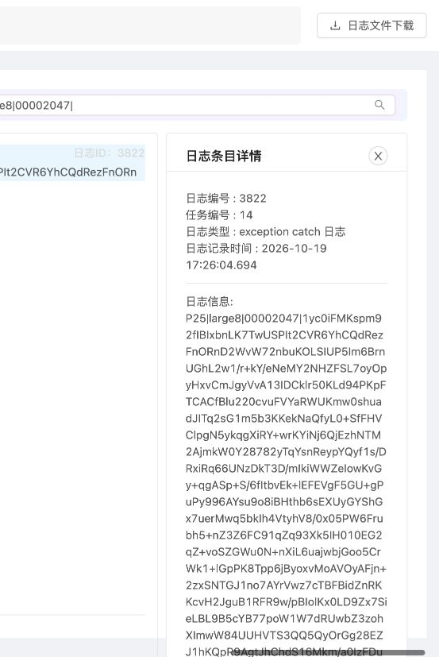

# iOS 连续上传及大日志整体链路验收

2026-10-19。本轮结论为**部分通过，32 MiB 未通过**。实际 iOS26.5 ARM64 模拟器运行原 Objective-C/CLogan SDK；隔离 Go/MySQL/本地 OSS 替身，原 LoganSite 页面实际查询、点击下载。Java 保留且未运行；不操作生产数据、不切流。本轮未修改 Go、Java、原 SDK 或原前端业务源码。

## 正式结果与耗时

日志正文为可复现的合成 ASCII 内容，每条带场景及连续序号。大日志每条4096字节，档位按**正文总量**计算，不是加密上传大小；连续上传每批新增100条、每条256字节，并上传当日日志的累计快照。

| 样本 | 累计正文条数，不含内部头 | 实际加密上传字节 | SDK上传调用→接口确认 | 上传调用→全部明细读回 | 写入开始→全部明细读回 | 结果 |
| --- | ---: | ---: | ---: | ---: | ---: | --- |
| 连续1，任务8 | 100 | 22,858 | 0.078s | 0.229s | 0.339s | 通过 |
| 连续2，任务9 | 200 | 45,528 | 0.010s | 0.212s | 0.216s | 通过 |
| 连续3，任务10 | 300 | 68,198 | 0.008s | 0.214s | 0.218s | 通过 |
| 连续4，任务11 | 400 | 90,868 | 0.007s | 0.221s | 0.225s | 通过 |
| 连续5，任务12 | 500 | 113,538 | 0.007s | 0.221s | 0.226s | 通过 |
| 1 MiB，任务13 | 256 | 812,646 | 0.060s | 0.224s | 0.259s | 通过 |
| 8 MiB，任务14 | 2,048 | 6,500,260 | 0.077s | 0.735s | 0.911s | 通过 |
| 32 MiB，首次 | 8,192 | 25,999,985 | 0.190s，业务失败 | 无成功样本 | 无成功样本 | HTTP200/code500 ERROR_DECRYPT |
| 32 MiB，新文件复测 | 8,192 | 25,999,873 | 0.115s，业务失败 | 无成功样本 | 无成功样本 | 同上 |
| 32 MiB，原示例单次上传时序 | 8,192 | 25,999,953 | 0.484s，业务失败 | 无成功样本 | 无成功样本 | 同上 |

连续5次的最近秩 P95/P99 均为0.229s，但只有5个样本，不能作为稳定分位数或生产性能指标。1/8MiB 各1个成功样本，不计算 P95/P99；32MiB 3次均失败，不填0、不从验收结果中剔除。正式10次中7次接受并完整核验、3次拒绝，**整轮不能标记为全通过**。这是一轮功能及边界验证，不是QPS/并发容量压测。

### 时间边界

客户端记录 NSDate Unix 时间；宿主观测器每50ms检查结果文件，发现确认后搜索对应唯一对象名/任务，再触发 brief 解析、按200个ID分批读取全部明细，最后一批响应完成后停止端到端计时。时间包含发现延迟、请求和完整明细读取；完整性哈希及 SQL 审计在计时后执行。测试使用同宿主模拟器时钟，不是跨物理设备时钟同步实验。

最初连续及1/8MiB外壳在计时前额外调用一次 `loganUploadFilePath`，因此“写入准备”包含该次 flush/快照；上传内部仍由原 `loganUpload` 再取快照。为排除这一因素，32MiB最后一次使用全新数据目录，仅调用原示例的 `loganUpload`，计时包含其自身 flush/快照，失败仍复现。没有拿计时范围不同的32MiB失败响应比较性能优劣。

五批上传按上一批SDK确认后继续追加，不是5个并行上传连接；后台解析/查询与后续批次可能重叠。相同历史内容出现在多个累计快照任务中符合现有接口语义，不是单任务重复解析。

## 已验证的完整性与 Web 链路

- 独立 Node/OpenSSL兼容的标准 AES-CBC 解密及 Python zlib 解压，逐帧逐成员核验真实模拟器上传文件；已接受7个样本合计3,811条（含每个任务1条内部头），内容、类型、时间与 API 全部一致。每个任务序号连续且数量符合客户端预期，没有重复ID或尾部丢失。
- 同批所有3,811条 SQL 内容字节数/SHA256、类型、时间逐条一致；7个处理任务均 done、owner空、lease0、fence1、revision1、attempts1、digest长度64、last_error空。重复 brief 返回相同ID。未人为注入过期租约或多实例抢占，本轮不声称验证了这些故障场景。
- 原 Web 页分别打开任务12/13/14，按最后一条序号过滤成功；任务14打开 detail3822，内容标记 `P25|large8|00002047|` 一致。
- 从原页面实际点击三次下载，浏览器生成的113,376、811,824、6,493,744字节文件，与各自 SDK 原始文件独立解密结果逐字节相同；不仅验证 HTTP 状态。下载仍依赖上一轮已配置的本地同源代理。
- SDK 清单176个文件，在原仓库及本轮临时构建副本中均重新计算指纹并匹配。SDK 代码没有改变；临时验收应用调用公开SDK API，独立 bundle/data container，关闭逐条控制台打印，并把单文件预算从原示例10MiB设为64MiB以容纳本轮样本。不能据此声称原示例默认10MiB预算可容纳32MiB正文。

可打开 [8 MiB日志验收页](http://localhost:3000/#/native-log-detail?tasks=14) 或 [连续上传最后一批](http://localhost:3000/#/native-log-detail?tasks=12)。浏览器及服务保留运行，模拟器自动化会话已关闭，应用仍安装。页面仅在本地临时服务存活时可访问。

## 32 MiB 失败证据与兼容边界

三份**未修改的实际 SDK 上传文件**均有4,338个完整 AES 帧，其后在 EOF 多出5字节 `01 00 00 00 00`：帧开始标记和零长度字段，没有完整帧尾。当前 Go Decoder 拒绝该空帧头并返回 `invalid Logan encrypted frame`，上传接口按现有契约映射为 HTTP200、业务码500、`ERROR_DECRYPT`。

独立诊断仅提取完整前缀，可解出4,338个完整 gzip 成员，包含8,192条4096字节正文及1条内部头。直接调用当前 Go Decoder 得到的有效前缀字节及 SHA256 与独立AES解密结果完全一致；三个样本均未触发历史 padding probe 拒绝，失败位置在末尾空帧头。**提取前缀只用于诊断，没有裁剪后重新上传，也没有作为端到端成功样本。** 单次 `loganUpload` 对照也失败，已排除测试外壳额外取快照是必要条件。

三次失败后，隔离库中该32MiB设备的任务数及 managed-object 登记数均为0，没有发布部分明细。本地 OSS 写入日志没有对应大对象写入。这不是本次 MySQL OOM、数据库写入慢或 brief 等待超时：上传即被协议校验拒绝，未到任务解析阶段。

原 [Java解析器](../../Server/src/main/java/com/meituan/logan/web/parser/LoganProtocol.java) 对该零长度数组也会进入异常路径，这是**源码推断，未运行 Java**；不能说是本轮实测了 Java 同样失败。原 [iOS包装](../../iOS/Logan.m) / [CLogan写入及flush](../../Clogan/clogan_core.c) 是后续排查空帧尾生成路径的入口。本轮已定位拒绝条件，尚未定位到SDK内部产生空帧尾的唯一语句或实现修复。

下一步应为该真实样本建立最小回归，再评估修复 SDK 生成边界，或由 Go 对“仅终端空帧头、此前所有gzip成员和记录完整”的情形增加明确受控兼容。后者会改变当前及Java参考的畸形帧拒绝行为，需要单独说明，不能在本轮验收中悄悄放宽。本轮保留现有协议校验、租约/fence及幂等保护。

## 稳定性观测与限制

同上一轮 Go 镜像 `sha256:695b049e2e9c135b1438060b755691484ffdd05d7a9c4998c2e314500a33ba34`；Go1CPU/1GiB、MySQL1CPU/2GiB、池8/4、显式 brief等待5s。数据库启用的 `lock_deadlocks`、`lock_timeouts` 计数均为0；三个容器最终 OOMKilled=false、restart0、running。

约3秒一次、各281个观测点的 Docker stats 采样内存峰值：Go39.46MiB、MySQL585.1MiB、OSS35.9MiB。这是 Docker stats 的采样工作集，不是精确瞬时峰值或RSS；不能据此配置生产内存。负载短且大档未成功，不能推断32MiB完整解析的资源占用或稳定性。

OSS 仍为本地字节传输替身，不验证真实云端签名、权限、TLS或公网。真实iPhone/Android、多实例、故障恢复、长稳、生产QPS及全部20接口未在本轮重测。`/readyz` 503门禁保留；原 Web 排序文案和类型命名问题沿用前轮记录。本轮不是生产上线许可。

## 预检、证据和复现

临时外壳预检曾遇到 storyboard outlet 缺失、异步首写前快照路径为空、重新安装后观测器持有旧数据目录，均保留日志并调整测试外壳；没有修改SDK解决它们。首轮还因只看HTTP200而错误显示“COMPLETE”，后续外壳加入业务码检查，实际结论始终按JSON业务码判定。预检共留下任务2～7，未采得有效正式端到端时间、也未触发其完整解析；它们保留为隔离测试数据，不混入正式任务8～14的计时或完整性统计。不能把未解析预检任务当成故障遗留租约。

[正式总账（failed）](evidence/ios-continuous-large-20261019/chain-result.json)、[7个成功样本明细](evidence/ios-continuous-large-20261019/verification-summary.json)、[数据库核验](evidence/ios-continuous-large-20261019/database-verification.json)、[浏览器下载核验](evidence/ios-continuous-large-20261019/browser-verification.json)、[3次失败诊断](evidence/ios-continuous-large-20261019/failure-summary.json)、[SDK指纹](evidence/ios-continuous-large-20261019/sdk-verification.json)、[资源采样摘要](evidence/ios-continuous-large-20261019/resource-summary.json) 及截图、UI回放、控制器/观测/独立解码脚本已归档。总核验器发现失败会退出1，保留失败总账；它不会把7个通过包装成全轮通过。

大体积合成上传原件、API全明细、下载和SQL逐条哈希保留在 ServerGo 的忽略目录 `output/ios-continuous-large-20261019`，约122MB，未作为版本化夹具；[大文件SHA清单](evidence/ios-continuous-large-20261019/large-artifacts-sha256.json) 已归档。完整前缀诊断产物另在 `/private/tmp/phase25-ios`。版本化证据不含数据库密码、密钥配置或用户真实日志。

复现须先按上一轮 [隔离环境说明](ios-simulator-e2e.md) 启动环境，在临时示例工程使用归档控制器，保持原SDK176文件指纹，构建后安装独立bundle；重新读取 `simctl get_app_container` 的当前数据目录再启动观测器，点击对应按钮。脚本默认使用 `/private/tmp/phase25-ios`、本机8888 API及上一轮私密 SQL helper，是本机验收记录，不是通用部署脚手架。不要读取或清空其他应用容器。32MiB原件可直接用当前Go Decoder复现拒绝，不需要启动或运行Java。
