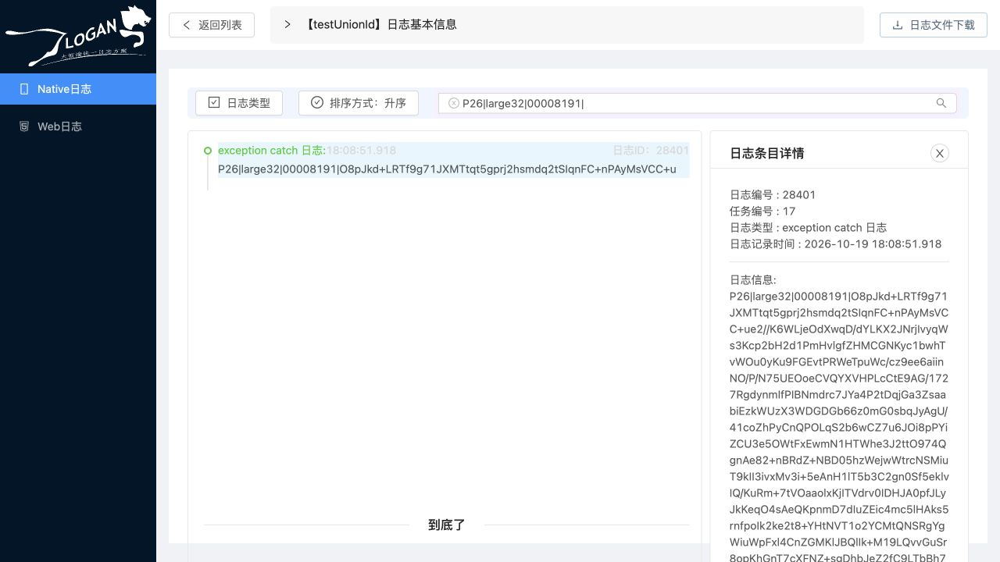

# iOS 32 MiB 空帧尾修复与整体链路复验

2026-10-19。**修复及本轮隔离复验通过**：修复 CLogan 生成端，保持 Go 原有拒绝校验；实际 iOS26.5 ARM64 模拟器三份32MiB日志、连续5次上传及1/8MiB回归共10次成功，28,390条记录完整。原Java保留且未运行，不操作生产数据、不切流。上一轮失败证据保留，不能把此前失败改写成通过。

## 根因与最小修复

问题不是32MiB大小上限：公开 CLogan API 写入3条4096字节日志就能复现。

`clogan_write2` 完成一个gzip成员、且尚未达到mmap批量落盘阈值时，会初始化下一个gzip并调用 `restore_last_position_clogan`，在缓冲末尾预留5字节帧头。此时 gzip 状态为 INIT、当前内容长度为0，但总缓冲还含此前完整成员。原 `write_flush_clogan` 仅在 ING 状态结束压缩，随后按总长度写盘，误把未使用的 `0100000000` 预留头当作数据写入。后续追加会使该空帧头出现在文件内部，因此不能只针对 EOF 做忽略处理。

[CLogan修复](../../Clogan/clogan_core.c) 仅增加9行：在 INIT、当前内容为0且缓冲不止一个预留头时，flush 写盘前从有效长度中排除这5字节并更新mmap长度；完成落盘后沿用原 `clear_clogan` 重建下一次写入的预留头。仅剩单个预留头时仍不落盘。没有截断日志内容、扫描修补既有文件，或改变AES/gzip协议。

Go解码器、严格gzip校验、请求/解压/记录预算、数据库迁移、租约、fence及幂等实现均未改动。

## 回归与保护

- **先失败后修复**：[原SDK失败日志](evidence/ios-empty-frame-fix-20261019/red.log) 中3条日志即可检测到末尾5字节；每3条flush后继续追加也会检测到内部零长度帧。修复后同一测试通过。
- [真实 CLogan 回归](../tests/sdk/native_flush_test.go) 在测试时编译仓库C代码，通过公开API生成加密文件，逐帧检查长度/帧尾、调用Go解码和严格gzip解压、核对完整序号及记录数。覆盖空flush、重复flush、追加写及32MiB正文；[实测日志](evidence/ios-empty-frame-fix-20261019/green.log) 全部通过。C编译器缺失时该测试会明确skip，不能把skip当SDK验收通过；本机确实编译执行。
- [上传拒绝回归](../internal/native/service_test.go) 覆盖完整SDK前缀后追加半截帧头、零长度帧头/帧和缺失密文：仍返回解密错误，不写OSS/业务任务，临时文件清空。现有CRC、截断gzip、连续成员、历史数据、取消和限额测试通过。
- Go `test/race/vet/build` 及Java源码兼容指纹检查全部通过，未运行Maven或Java服务。[完整检查摘要](evidence/ios-empty-frame-fix-20261019/full-checks-summary.json) 已保留。
- 当前源码重新编译的真实MySQL回归通过，使用隔离库及随机子库。覆盖发布回滚/幂等重试、竞争租约、旧owner/fence失效及解析进程强杀恢复；实测 running fence1/attempt1 → done fence2/attempt2、单条发布且重复读取ID稳定。见 [MySQL回归日志](evidence/ios-empty-frame-fix-20261019/mysql-tests.log)。这不等于在本轮SDK负载期间注入故障或验证生产主从切换。
- 重建的Go容器对上一轮**未修改的32MiB失败原件**仍返回 HTTP200/code500/ERROR_DECRYPT；没有创建对应任务或managed-object登记。[原件拒绝证据](evidence/ios-empty-frame-fix-20261019/old-malformed-rejection.json) 保留。

复跑大日志SDK回归：

```sh
LOGAN_SDK_LARGE_REGRESSION=true go test -tags stdjson ./tests/sdk -run TestNativeSDKFlushHasNoEmptyFrame -count=1 -v
```

## 实际模拟器端到端时间

全部由修复后SDK在独立应用数据目录生成，未裁剪或重写生成文件。32MiB为8192条、每条4096字节的正文总量；实际加密上传约26MB。临时示例单文件预算64MiB；原示例默认10MiB预算未修改，不应声称其默认配置可以容纳本轮样本。

| 场景 | 任务 | 实际上传字节 | 上传调用→确认 | 上传调用→完整brief索引 | 上传调用→全部明细读回 | 写入开始→全部明细读回 |
| --- | ---: | ---: | ---: | ---: | ---: | ---: |
| 32MiB A | 15 | 25,999,948 | 1.044s | 3.191s | 8.483s | 8.992s |
| 32MiB B | 16 | 25,996,908 | 0.536s | 1.652s | 2.898s | 3.198s |
| 32MiB C | 17 | 26,000,716 | 0.519s | 1.555s | 2.724s | 3.018s |
| 连续5次累计100～500条 | 18～22 | 22,858～113,554 | 0.006～0.047s | 0.136～0.211s | 0.213～0.243s | 0.214～0.360s |
| 1MiB | 23 | 812,630 | 0.076s | 0.192s | 0.241s | 0.257s |
| 8MiB | 24 | 6,500,292 | 0.176s | 0.540s | 0.857s | 0.944s |

32MiB三次全部通过，较上一轮3次全部拒绝恢复了整体链路。**不是用失败响应的耗时与成功完整读取比较性能。** 三样本中位数2.898s，最近秩P95/P99均8.483s，但样本过少，不是稳定分位数、QPS或长稳承诺。保留较慢首样本；未证明其与后两次差异的唯一原因。

计时从客户端调用原 `loganUpload` 前开始，包含SDK自身flush/快照/网络上传。宿主每50ms观测回调文件，通过返回对象名匹配任务，触发brief后台解析，再按200个ID分批实际读取所有明细；最后一批读回后停止计时。包含观测、请求、网络传输和JSON处理，不包含随后独立哈希/SQL审计及人工浏览器操作等待。六个应用均不额外调用上传前快照；连续上传按上批SDK确认后继续追加，并非5个并行上传连接。

### Go分段证据

以下为真实处理任务的服务端记录，单位秒；publication 包含数据库插入等子阶段，不能把所有列重复求和。队列不计入worker执行时长。

| 32MiB任务 | 排队 | 解压 | parse_stage | db_insert（publication子集） | publication | worker执行 |
| --- | ---: | ---: | ---: | ---: | ---: | ---: |
| 15 | 0.008 | 0.558 | 0.434 | 0.625 | 0.896 | 2.073 |
| 16 | 0.003 | 0.284 | 0.203 | 0.301 | 0.444 | 1.040 |
| 17 | 0.004 | 0.263 | 0.172 | 0.251 | 0.371 | 0.904 |

首个完整读取样本8.483s中，brief结束后全明细分批读回占5.292s；后两次约1.245/1.169s。不能把8.483s全部称为Go解析耗时。见[原始阶段日志](evidence/ios-empty-frame-fix-20261019/processing-stages.log)。

## 数据、审计与原Web页面

独立 Node标准AES解密与Python zlib逐成员解压10份实际上传原件，全部记录的内容、类型、时间与Go API逐条一致；所有序号、字节数和记录数符合客户端预期。三份32MiB各4338个完整帧/4338个gzip成员、8193条记录（含1条内部头），不再有未使用帧头。

隔离MySQL中28,390条明细的字节数、SHA256、类型和时间全部匹配。10个任务均done、owner空、lease0、fence1、revision1、attempt1、digest长度64、last_error空；重复brief的ID稳定。旧坏原件重放没有入库或对象登记副作用。启用的MySQL deadlock/lock_timeout指标均0，Go/MySQL/OSS容器无OOM和重启。

原LoganSite分别查询任务15/16/17的最后一条 `P26|large32|00008191|`，并实际点击页面下载。三份浏览器文件25,973,920、25,970,880、25,974,688字节，分别与其SDK原件独立解密结果逐字节相同。任务17打开detail28401核对完整内容。可直接查看[32MiB验收页面](http://localhost:3000/#/native-log-detail?tasks=17)。



完整性及下载证据：[总账](evidence/ios-empty-frame-fix-20261019/chain-result.json)、[10样本及耗时](evidence/ios-empty-frame-fix-20261019/verification-summary.json)、[SQL审计](evidence/ios-empty-frame-fix-20261019/database-verification.json)、[浏览器文件哈希](evidence/ios-empty-frame-fix-20261019/browser-verification.json)。

## 兼容差异及未覆盖项

1. **需要更新并重新编译移动端SDK。** 修改的是共享CLogan生成端，不是仅更换Go服务就能修复旧客户端。仓库与模拟器编译副本的176个SDK文件重新比对，仅 `clogan_core.c` 为本次预期修改，另175个文件不变，见[指纹差异](evidence/ios-empty-frame-fix-20261019/sdk-diff-verification.json)。
2. 新生成文件不再含未使用的零长度预留头；正常帧、加密、连续gzip、业务接口/响应保持。Go仍拒绝零长度、截断、损坏及超限输入，未增加宽松恢复入口。此前已损坏的在盘历史文件不会自动修复，后续追加也不保证消除旧坏帧，需要单独的受控恢复方案；本轮未对其补数。
3. 原Java完整保留，源码指纹通过。新SDK输出遵循原协议，**未运行Java读取复验**，不把源码推断当Java实测。Android/JNI、真机和旧SDK升级后已有文件的处理未在本轮验收。
4. OSS仍是本地字节传输替身，未验证真实云端凭据、签名校验、TLS、公网。原前端仍使用上轮同源下载代理；既有排序文案及类型命名差异未修改。
5. 本轮是短时功能/边界复验，不是全部20接口重测、多实例SDK故障注入、生产容量或一小时/24小时长稳。`/readyz`仍503，未打开生产门禁。

## 镜像、资源及保留环境

当前源码交叉编译linux/arm64 Go二进制，再用缓存运行时基础镜像组装新镜像；本轮没有在线重跑官方多阶段Dockerfile。新镜像 `logan-phase26-strict:local`，ID `sha256:8ee3667ae366c21c8092f1af24ec1316070a1b005594be2bdf1221ce7cdc1db2`。服务二进制SHA256仍为 `b3a0acb55da0036827a886f7e9b10cd874dba113ff5c162709fcaacc10adbfde`，与修复前一致。

Go1CPU/1GiB、MySQL1CPU/2GiB、连接池8/4、显式brief等待5s保持。为保留三份大对象，**仅本地OSS替身**从128MiB调整为256MiB；这不是生产OSS配置或Go性能优化。约3秒一次、各164点的Docker stats采样内存峰值为Go46.12MiB、MySQL767.1MiB、OSS117.3MiB；非瞬时峰值/RSS，不据此给出生产预算。隔离VM最终磁盘仍有约3.4GiB余量。

新容器 `logan-ios26-go` 使用原隔离数据库/OSS，旧 `logan-ios24-go` 已改名 `logan-ios24-go-phase25` 并停止保留；Java未涉及。网页3000、Go8888及OSS18081仍仅本机访问，模拟器自动化会话已关闭、应用保留。私密配置仍在临时运行目录，不进入仓库；本地OSS对象在内存中，停止环境会丢失对象，原件和下载已归档。

小证据、截图、UI回放、控制器及核验脚本见本页证据目录及[SHA清单](evidence/ios-empty-frame-fix-20261019/sha256.json)。约481MB合成原件、API全明细、下载、逐条SQL哈希保留在忽略目录 `ServerGo/output/ios-empty-frame-fix-20261019`，[大文件清单](evidence/ios-empty-frame-fix-20261019/large-artifacts-sha256.json) 已归档。临时构建/观测脚本在 `/private/tmp/phase26`；它们引用本机临时路径，不是通用部署脚手架。没有归档运行密码、DSN或私钥。
