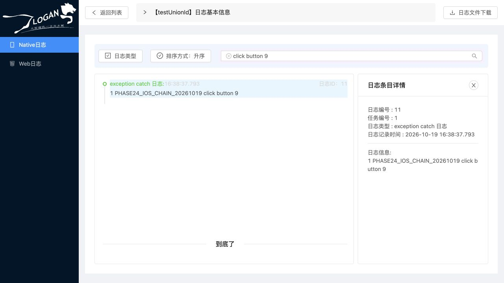

# iOS 模拟器 → Go → LoganSite 整体链路验收

2026-10-19，本地隔离验收通过。使用实际 iOS 26.5 ARM64 模拟器、原 Objective-C/CLogan SDK、Go 容器及原 LoganSite 页面；未运行 Java、未操作生产数据、未切流。本次没有修改原 SDK、Java、前端或 Go 应用源码。

## 查看结果

环境保留运行，可打开 [任务 1](http://localhost:3000/#/native-log-detail?tasks=1) 或 [移动端任务列表](http://localhost:3000/#/native-list)。搜索设备 `phase24-ios-simulator-20261019`、平台 iOS、日期 `2026-10-19`。API 为 `http://localhost:8888/logan-web`。

模拟器 `MobileInspector-Harness-20261016`（DB07B9B4-2C49-40DE-B8E1-72931CFEB2D6）已安装独立示例应用 `org.logan.acceptance.phase24`；自动化会话已关闭，模拟器和服务保留。此地址依赖本机临时运行环境，不是持久部署。

## 实测结果

| 环节 | 证据与结果 |
| --- | --- |
| 原 SDK 构建 | Xcode 模拟器构建成功；清单内 176 个 SDK 文件在仓库和临时构建副本的 SHA256 全部一致 |
| 实际 UI 写入/上传 | 点击“测试日志写入”生成 0～9 十条标记，点击“测试日志上报”经原 NSURLSession 上传；设备和内容标记仅在临时示例副本中设置 |
| 分帧及连续 gzip | 真实上传 466 字节，包含 3 个 AES 分帧、3 个 gzip 成员；独立 OpenSSL 解密及 gzip 解压得到 11 条记录 |
| 完整性 | 10 条测试记录及 1 条内部 `clogan header` 与 Go API、真实 MySQL 中的内容、类型、时间逐条一致；SQL 内容 SHA256 全部相等 |
| Web 查询 | 原页面按设备/iOS/日期找到任务 1；完整列表 11 条；关键词 `click button 9` 返回 detail 11，打开详情内容一致 |
| 排序/类型 | 升降序数据顺序正确；类型选择器显示 type 1；升序已恢复 |
| 实际浏览器下载 | 浏览器下载事件得到 448 字节 gzip；下载字节与对真实上传文件独立解密的结果完全相同 |
| 任务与幂等 | 任务 done，owner 空、lease=0、fence=1、revision=1、attempts=1、digest 长度64、last_error 空；重复 brief 的 ID 稳定为1～11 |

上传 SHA256：`934fa060d9cd536eaf023b5882d7ab5c237ef4912cdc042d459be4c21ac42762`。

下载 SHA256：`74faa2433690da6d48f6c73e876cd2d5e9816a08b35b387aa53518f4b8c1689c`。

## 本地部署适配及已知差异

原前端把 `/logan/downing?name=...` 拼在前端域名下，最初下载返回404。临时前端服务器已增加同源转发：`/logan/*` 转到 Go 的 `/logan-web/logan/*`，保留查询串、302 和 Location；修正后在浏览器实际下载成功。该部署适配应在正式网关中保留；没有改变兼容接口。临时代理的7项路径/查询安全检查通过。

原前端依赖 node-sass4，无法直接在本机 Node24 构建；仅临时副本改用 Sass1.77.8，并启用旧 OpenSSL 兼容选项，生产静态构建通过，原前端文件保持原样。

原 Web 排序按钮在降序时仍显示“升序”，数据本身顺序正确；本轮记录该既有显示问题，未改动。示例将 type1 称为 Action，Web 显示“exception catch 日志”；数值及内容保持一致，这是既有命名差异。

## 范围和限制

- OSS 为本地字节传输替身。实际使用 SDK 生成的签名 URL 和重定向，但替身不校验签名；未验证真实云端权限、签名有效性、TLS 或公网网络。
- 本次仅验实际 iOS 模拟器和466字节日志，不代表真机、Android、大日志、全部20接口、容量、长稳或故障恢复已经在本轮验证。
- `/livez` 及业务路由可用；`/readyz` 仍按原门禁返回503（integration and production validation pending），没有打开生产就绪门禁。
- Go 镜像 `logan-phase23-fixed:local`，镜像 ID `sha256:695b049e2e9c135b1438060b755691484ffdd05d7a9c4998c2e314500a33ba34`；Go 1CPU/1GiB、连接池8/4，MySQL8.4.11 1CPU/2GiB，独立数据库 `logan_ios24`。不据此推断生产容量。

## 证据与复现

[完整性核验](evidence/ios-simulator-20261019/chain-verification.json)、[数据库及 SDK 独立核验](evidence/ios-simulator-20261019/final-database-verification.json)、[SDK 指纹清单](evidence/ios-simulator-20261019/source-manifest.json)、[证据 SHA256](evidence/ios-simulator-20261019/sha256.json) 已归档。UI 回放为纯文本 `.trace`。归档只含合成日志和公开示例 SDK 数据，不包含运行凭据。

临时构建及核验脚本在 `/private/tmp/phase24-ios`；前端构建/代理在 `/private/tmp/phase24-frontend`；隔离容器运行及清理说明在 `/private/tmp/phase24-runtime/README.md`。这些临时目录不保证重启后存在。实际下载也保留在本机 Downloads。环境私密配置未写入仓库；保留运行期间不要删除对应配置或共享资源。
