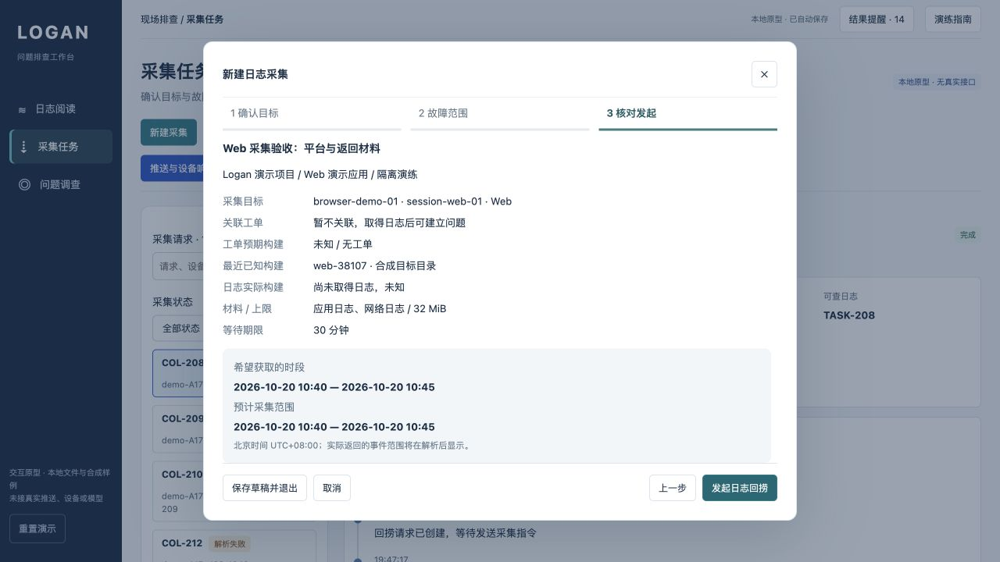

# 采集流程更新

> 当前回捞入口以 [阿里云回捞流程](aliyun-retrieval-flow.md) 为准：工单 / 手动参数 → 阿里云推送 → 客户端接收上传 → 平台接收后回捞成功。此前合成目录和命令字段仅保留作历史演练，不作为已确认协议。

日期：2026-10-21。依据已确认的 [采集复审](collection-flow-review.md)，更新本地产品原型及开发契约。保留原有采集、日志、解析、源码、AI、验证和工单能力；没有接真实接口。

## 发起路径

**确认目标 → 故障范围 → 核对发起。** 弹窗内容可滚动，底部操作固定可见。

1. 从采集中心进入，默认不关联工单；从工单进入，继承现象与故障时段，明确其为待核对线索。已解决工单默认走独立采集，避免无提示追加。
2. 按应用过滤或搜索设备、安装、Web 会话，选择目标卡片；显示项目、应用、环境、平台、安装/会话标识、最近已知构建、最近联系与能力来源。能力不再由用户手动选择。
3. 填现象和故障范围，时区固定北京时间并明确显示。可使用目标对应的固定合成样例时段。按日目标只提供混合文件，扩大范围须确认。预算、等待期限、结果提醒折叠在高级设置。
4. 核对页展示目标、材料、工单、工单预期构建、设备最近已知构建和“尚未取得日志”的实际构建。未知目标或离线页面不允许发起。
5. 草稿自动保存；可保存退出、继续或重新填写。提交失败留在当前步骤并说明原因。

目标目录目前只有明确标注的 Native、Web 活动页面及 Web 离线三个合成样例。没有真实设备搜索、动态在线状态或自定义能力认证。未知目标可保存草稿；现有导入入口仍需选择已有工单。

## 返回材料与继续调查

- 详情先展示采集目的、目标、当前状态和下一步；原有推送阶段控制、失败重试及取消保留。详细时间线可展开。
- 请求时段、预计采集范围、实际观察事件范围分开显示。已收到文件、可读文件分开计数，上传失败文件不算已收到。
- Native 目录最近已知构建为 38108，返回样例声明为 38107；进入源码调查仍使用 38107。
- 独立采集可先阅读、关键词筛选、展开原始字段、下载与重新解析，不创建占位工单。独立材料也在日志入口提供阅读入口。
- 关联已有工单或建立新问题需核对目标和用途。请求 ID 和稳定来源键不变，独立解析资产转入工单资料库；随后继续原有日志、源码、证据、AI、验证及回写流程。
- 部分成功只读取成功文件对应的事件；重试产生新请求，原请求状态和材料不覆盖。

独立采集的重解析目前使用已保存的合成明文及自动严格解析，直接给出结果与历史；关联工单后进入完整解析配置与历史界面。真实加密协议、设备上报、服务端解析与权限控制仍是开发项。

## 数据兼容与边界

沿用 localStorage v2；新建独立请求放入 collectionRequests，关联后转入真实工单 requests。product.flowVersion=2 标识本轮新请求；旧请求仍使用原有字段，不静默迁移其元数据。新增目标快照、工单预期线索及返回材料声明彼此独立。

复审指出的“独立采集无需工单”已同步到 [对象规格](specification.md) 和 [接口契约](api-contract.md)，并补充 CF-01～06 验收条件。接口文档描述开发目标，不代表接口已存在。

本轮浏览器和测试结果见 [验收记录](../../../prototypes/logan-investigation/evidence/collection-flow-2026-10-21/report.md)。

## 入口与命名对齐

导航与页面统一为「日志回捞」，列表为「回捞请求」，详情为「回捞进度」。

- 「回捞设备日志」：从设备或 Web 会话取得故障期间已保存的日志；不能补录未记录的内容。沿用三步表单和可选工单关联。
- 「上传日志文件」：从日志回捞页或日志阅读页打开已有导入与解析流程，当前仍需选择工单，不创建设备回捞请求。
- 「补充采集」：位于问题调查工作台，针对证据缺口再次回捞；带入当前问题线索，返回后显式选择新增证据。

本次仅调整入口与说明；请求编号、保存的数据、路由和状态流转保持兼容。

## 推送驱动的回捞流程（纠偏）

此前三步流程只突出目标与日志范围，最后提交停在待推送，容易误解为直接从设备取文件。现按业务纠正为：**确认推送目标 → 配置回捞指令 → 确认并推送**。

1. 在应用 / 环境下查找接收对象，核对通道、推送绑定和接收标识。设备 ID 用于找到绑定，不能替代推送接收标识。没有绑定则不能发送，可保存草稿或导入已有文件。
2. 配置故障时段、日志类型、上传上限与有效期。按日 SDK 的指令使用已确认的整日范围；故障期望范围仍单独保留。
3. 最终按钮「发送回捞推送（模拟）」创建回捞请求并向合成通道提交一次。保存独立推送 ID、关联回捞 ID、路由、指令快照、提交时间、到期时间及接受 / 拒绝回执。
4. 通道接受后等待设备送达与 SDK 响应；客户端执行回捞、另行上传文件，解析后才可阅读。无送达回执时保持未知，可凭 SDK 的后续响应继续；通道失败不会产生文件。
5. 失败重试创建独立推送与请求，保留原请求；取消不抹去已收到的通道回执。上传文件与重新解析不触发推送。

Web 示例明确为**业务消息通道的合成订阅**，不是浏览器原生 Web Push，也不代表真实 Logan WebSDK 已支持。仅有历史会话、没有消息绑定的目标不能发起推送。现有旧请求缺少推送快照，不补造历史 ID 或回执；新增请求采用上述规则。

回捞成功后的阅读、源码、AI、验证和回写流程保持不变，仍未接任何真实接口。
