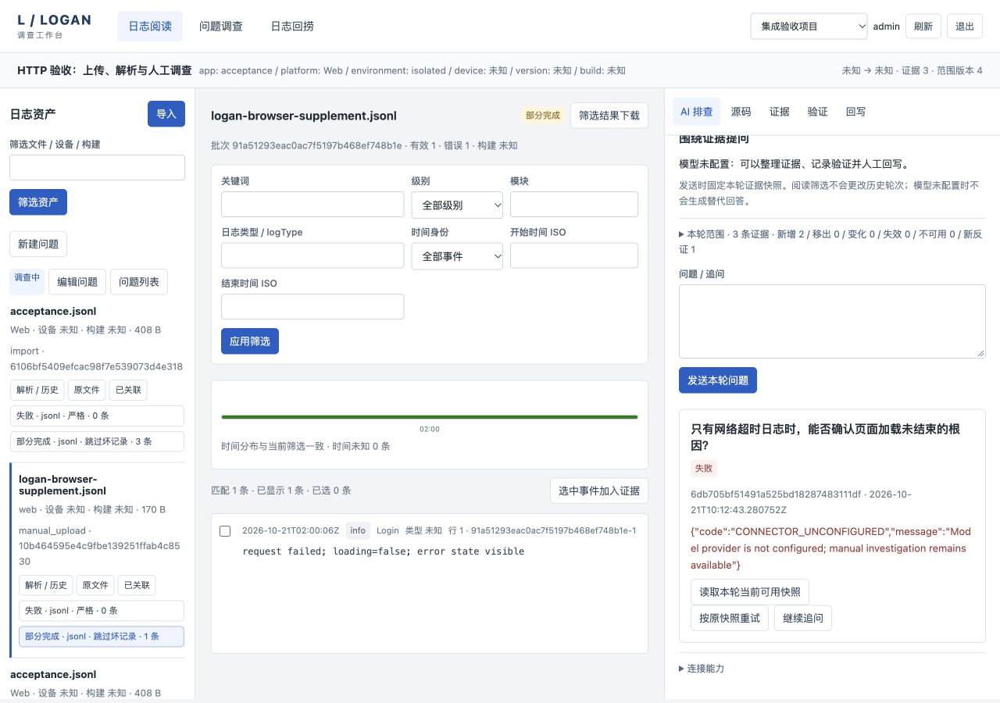
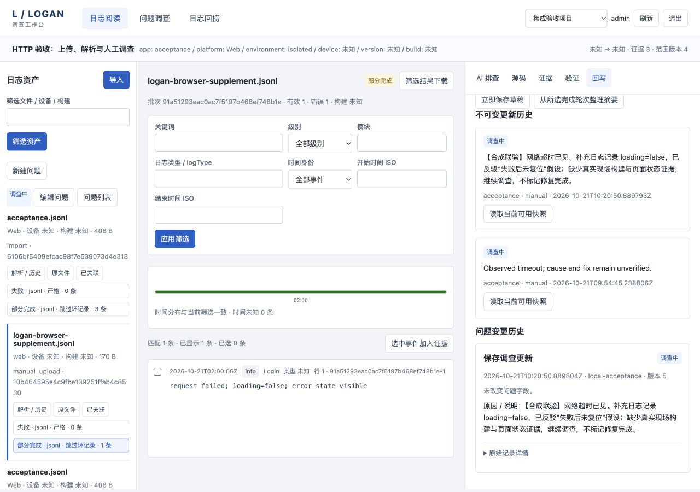

# 正式工作台本地验收记录

日期：2026-10-21。范围：独立 Go 工作台、嵌入浏览器客户端、隔离持久化、实际本机 Git 与测试 HTTP 连接器。输入均为合成数据，不读取原型导入的用户内容，不向远程模型发送内容。

## 自动验证

[检查摘要](verification-summary.json)与[真实 HTTP 报告](http-acceptance.json)记录本次通过项。

| 验证 | 实际结果 |
| --- | --- |
| Harness full | `make test`、`make race`、`make vet`、`make build` 全部通过 |
| 独立工作台构建 | `go build -tags stdjson ./cmd/workbench` 通过 |
| 新客户端 | 16 项通过，包含所有模块的浏览器 ES module 语法检查 |
| 原型回归 | 124 项通过，原型文件与原有浏览器数据保留 |
| 最终程序 HTTP | 15 项通过：认证、幂等冲突、修订冲突、上传 hash、严格失败后重新解析、版本比较、筛选、证据、未配置渠道/模型、草稿恢复及一次回写 |
| Harness 自测 | 17 项通过；输出中的注入失败/阻塞属于检查器自身的预期测试 |
| 源码及 AI 整链 | 实际临时 Git 两个 commit；API 上传/解析/构建映射/错误版本拒绝/片段/差异/收藏；本机测试模型两轮、补证不改旧快照、AI 草稿确认写入并保留来源 turnId |

Go 测试还覆盖：存储重启与独占锁、提交故障停止服务、跨项目/角色/原文件下载权限、SDK 协议不能绕过为明文、假设及版本、最新修复验证和重开门禁、多轮派生内容的撤权和到期清理、过期旧材料替换后继续回写、历史 tombstone 导出。SQL 测试使用 sqlmock，不能声称真实 MySQL 已通过。

## 浏览器实际流程

在最终服务的隔离验收项目操作，并在重启与刷新后核验原对象仍存在：

1. 打开原调查 `1d08e8526692b736b514e320ccd0e1f1`，原网络日志及失败/部分完成批次保持可读。
2. 通过真实文件选择器上传 `logan-browser-supplement.jsonl`，文件 170 字节、2 行，其中一行损坏。新资产 `10b464595e4c9fbe139251ffab4c8530` 自动关联当前调查，未知设备/构建仍保持未知。
3. 严格解析 `5707d494694b5c19f2e8f9cddd24921f` 失败，诊断指出第 2 行 JSON 无效；没有发布半批事件。
4. 改为跳过坏记录，新解析 `91a51293eac0ac7f5197b468ef748b1e` 为部分完成，1 条有效、1 条错误。旧失败批次不被覆盖。
5. 选择有效应用日志加入同一调查。范围版本从 2 到 3，证据从 1 到 2。
6. 新建人工假设 `e3b45705db81724c46b0364c840e5abf`，记录“失败后 loading 未复位”待验证；以明确记录 `loading=false` 的合成日志保存反驳，而非根据超时推定 UI 根因。
7. 反驳记录进入下一轮范围；界面显示 3 条证据、2 条新增、1 条新反证。原轮次固定快照保留。
8. 未配置模型时实际提问，轮次 `6db705bf51491a525bd18287483111df` 明确失败 `CONNECTOR_UNCONFIGURED`，没有虚构回答。
9. 输入人工摘要、立即保存并刷新，预览前草稿恢复；生成固定引用的预览，明确确认回写。历史新增记录说明仍需真实现场证据，工单保持调查中，没有把反驳假设当成修复通过。
10. 重启到最终二进制，再次打开原问题，资产、解析、证据、反驳和内部更新历史仍存在。变更历史显示执行人、时间与原因；原始结构折叠。最终版本加载后无新增浏览器 JavaScript 错误。

## 响应布局与截图

检查了浏览器原有约 400px 宽度的堆叠布局及 1280×900 桌面三栏布局。桌面验收后已恢复原尺寸。

截图只证明显示；保存与关联结果同时由真实 HTTP 和持久化测试核验。测试模型是明确标记的本机协议测试服务，未作为浏览器里的真实 AI 诊断呈现。

## 本次未签发的结论

- 阿里云及客户端推送、回执、上传回调按用户决定暂缓，正式服务不会模拟成功。
- 实际模型质量和 20 个固定样本的业务人工评审尚未执行。
- 真实 MySQL、备份恢复、高可用、目标容量/p95、远程仓库 ACL 与 CI/SDK 身份仍需环境验收。
- 旧任务适配为显式映射后的只读任务/详情，不承诺全局历史检索或自动迁移。
- 本次结论是可运行、可验证的第一版本地试用实现，不是生产发布批准。
