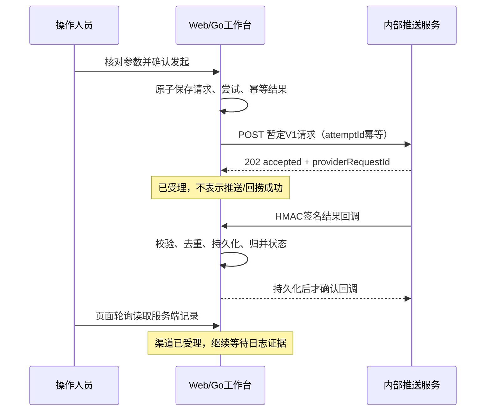

# 内部推送服务与平台回调 V1：暂定协议和验收

日期：2026-10-26。基于 19ce77f 后的本轮工作区实现，尚未提交/推送。用户确认内部推送服务还没有协议，先由平台定义一套使用，后续替换适配层。本文件描述该暂定协议与已执行的隔离验收，不代表已有内部服务、阿里云或客户端联调通过。

## 1. 接入边界

平台负责工单/手工参数、回捞请求与发送尝试、调用内部服务、校验回调、保存状态并让 Web 刷新。内部服务负责将 V1 请求适配为实际下游推送调用和移动端命令，并把它能证明的结果回调平台。平台不直接接阿里云，不把包名当 AppKey，不自行构造尚无实际客户端约定的指令。

本轮只打通推送作业与回调阶段。现有 SDK 上传、解析和阅读继续保留为独立资产链路；尚未建立 App 上传与本次 requestId/attemptId 的自动关联。推送回调不能写入文件、解析结果或直接把回捞标记完成。人工导入也不会冒充自动回传。

## 2. 三种“成功”分别认定

| 事实 | 证据 | 能推进到哪里 |
| --- | --- | --- |
| 内部服务受理 | HTTP202 和有效任务号 | 等待推送回调 |
| 下游推送渠道接受发送 | 内部服务签名的 push_succeeded 回调 | 渠道已受理，等待日志；不表示设备收到 |
| 客户端收到、日志上传或平台文件落地 | 本轮没有这些回执协议 | 保持未知；禁止根据前两个事实补造成功 |

push_failed 表示内部服务明确回调渠道失败。HTTP4xx 拒绝和网络/超时/5xx 导致的结果未知分开保留；未知不会自动重发。回调晚于取消、截止时间或属于旧尝试时，记录事实但不复活当前流程；相互矛盾的后续推送终态不回退已有状态。

## 3. 暂定接口

详细 JSON、签名方式和私有配置见 [开发运行协议](../../../Logan/ServerGo/docs/internal-push-v1.md)，完整平台设计见 [设计规格](../../superpowers/specs/2026-10-26-internal-push-callback-design.md)。

| 调用方向 | 接口 | 认证及关键约束 |
| --- | --- | --- |
| Web → 平台 | POST /logan-web/api/workbench/v1/collections，传 draftId/draftRevision | 项目 Bearer 授权、角色、UUIDv7 幂等；服务端读取真实草稿参数，不回传脱敏值当作目标 |
| 平台 → 内部服务 | 运维固定配置的 endpoint，POST V1 JSON | 独立 Bearer 凭据，Idempotency-Key=attemptId；不接受用户指定地址；HTTP202 仅代表作业受理 |
| 内部服务 → 平台 | POST /logan-web/api/workbench/v1/integrations/push/events | 独立 HMAC-SHA256；签名覆盖时间戳、换行和精确原始请求体；不使用浏览器令牌 |
| Web → 平台 | GET /collections、/{id}、/{id}/attempts、/{id}/events | 当前项目授权；服务端状态为准 |
| Web → 平台 | POST /collections/{id}/retries 或 /cancel | If-Match、confirmed=true、原因；显式确认可能重复触达，保留原尝试，最多五次 |

V1 请求含 schemaVersion、requestId、attemptId、projectId、app、target、context、callbackURL、deadlineAt。begin/end 仍是可选排查上下文，均空可发送，填写时需完整且有序；设备目标不强制账号绑定确认，账号/别名必须由操作人确认已绑定。用途可空，不借用工单设备字段充当云端推送标识。

回调含 schemaVersion、eventId、requestId、attemptId、providerRequestId、eventType、occurredAt，可选 reasonCode。支持 push_succeeded/push_failed；同 eventId 同正文仅应用一次，改正文则409。服务端另外记录 receivedAt。签名传输时间允许前后五分钟偏差，请求体上限64KiB；默认跟踪截止十分钟，可配置60秒至24小时。无回调不等于推送失败。

回调确认只在持久化成功后发出。存储失败返回503并阻止后续操作；旧状态不被部分结果覆盖。外呼并发最多两路，独立于日志上传限额；网络调用不持有全局业务锁。重启时进行中的未知外呼不盲目重发，已有回调、尝试和幂等记录保留。

## 4. 页面与数据保留

保留原三项主导航、回捞三步向导、三种追踪视图、草稿、导入、阅读及人工调查。未配置服务时仍只能保存草稿；明确配置并授权后才启用发起。原始参数草稿和正式请求分开显示，发送过的参数草稿标注“已发起”。

推送处理中页面按两秒轮询更新；保持当前请求和调查上下文，历史展开状态按项目/请求保留。重试后转到推送视图跟踪原请求的新尝试，避免新尝试被失败筛选排除而跳到另一条旧请求。发生/接收/截止时间显示北京时间。

发送准备或结果不确定后，锁定参数、返回及另存草稿动作，只允许沿用原提交查询/重试或关闭检查。不能出现确认目标B却发送缓存目标A。账号/项目切换后，迟到结果不改变新页面；提交结果丢失先查询持久化操作，不自动换编号重发。

新请求、尝试和回调遵循既有内容留存，目标及操作原因到期后按原机制清理，并覆盖操作快照/幂等回执中的副本。此次没有改写旧数据、密钥、SDK 或设计 CSS，没有迁移真实运行目录，也未重启原 8091 工作台。

## 5. 已执行验收

| 范围 | 结果与证据 |
| --- | --- |
| Go 后端 | 新增11项测试；完整 Harness 的 test/race/vet/build 全通过；最后 UI 修正后嵌入资源测试和交付构建再通过 |
| Web | 85项通过，原75项保留；新增状态含义、实际组件操作、结果恢复、跨项目、锁定旧提交、历史展开保留与重试选中回归 |
| Python 既有工具 | 47项通过；没有改变旧启动/备份/手机验收工具 |
| 推送真实 HTTP | 12项通过：真实工作台进程调用本机服务替身、签名回调、伪造/过期拒绝、重复/冲突、回调早于响应、未知重试、旧回调/取消、HTTP拒绝、重启幂等、不重放外呼 |
| 原人工调查链路 | 原14项业务检查＋8项阅读/隔离/重启/备份恢复综合检查全部通过 |
| 浏览器主流程 | 使用三步向导发起合成设备请求；真实HTTP服务替身返回并签名回调；无需手工改本地状态，页面自动显示渠道已受理并继续等待日志；参数草稿和其他入口仍在 |
| 独立复审 | 修复“发送未知后确认参数与缓存不一致”P2后通过；浏览器发现的历史自动收起和重试后丢选中问题另有组件回归；未留下已知重要代码问题 |
| 保留检查 | 本轮开始已有的19份未提交文件摘要未变。真实日志/凭据不写入版本化报告；演练使用单独目录/随机凭据 |

浏览器截图记录原有导航、布局和本轮真实回调状态：[回调后的追踪页面](evidence/internal-push-v1-callback-2026-10-26.png)。[机器可读验收记录](evidence/internal-push-v1-acceptance-2026-10-26.json) 仅保存合成/脱敏证据，不包含访问令牌。

浏览器演练环境不是原业务工作台。当前演练页的地址和临时登录信息保留供查看；更新其测试构建时，授权配置、推送配置、完整测试状态三份文件逐字节一致。演练中的内部服务是协议替身，不会真正向阿里云或手机发送消息；不将其成功回调当作实际设备送达验收。生产内网网络、证书、回调连通性及真实服务语义映射仍需实际环境验收。

## 6. 后续替换与接通

1. 内部服务先按 V1 实现受理与回调，或在该服务外层提供兼容适配；平台域模型和页面无需跟着改供应商字段。
2. 运维在平台配置 endpoint、独立外呼凭据、callbackURL、独立签名密钥、项目范围；使用私有配置文件。内网网关要允许内部服务访问回调路径，不能用浏览器统一登录页拦截它，且仍验证 HMAC。不要开放匿名业务 API。
3. 在内部服务实现相同 attemptId 的幂等承诺；平台本地幂等不等于供应商或设备天然支持精确一次。明确推送成功的真实语义后再映射事件。
4. 单独补 App 指令、客户端收到/上传回执与文件关联协议，依据真实 requestId/attemptId 建立回捞归属；不能按最新设备或时间接近自动认定。
5. 备份时显式保存推送私有配置及所需密钥文件；现有备份工具不自动抓取环境变量。未经要求不改现有私有配置或部署。

本次尚未连接真实内部服务或阿里云、未增加源码映射或 AI、未自动关联手机回传、未提交/推送新改动。这些边界不影响原日志上传解析阅读与人工调查继续使用。
