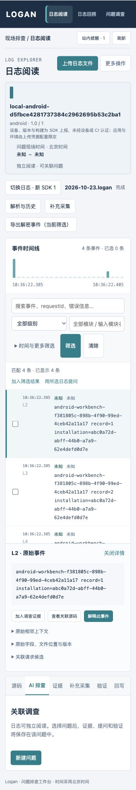

# 真实 Android 手机 → Go → Web 与持久化验收

日期：2026-10-23。范围为本地独立工作台、仓库 Android 示例 App 和已连接的实体 Android 手机。没有接入阿里云推送、源码映射或模型服务。此次没有修改正式 Web 的导航、布局或 CSS。

## 本次实际跑通的路径

实体 Android 手机运行独立调试包 `test.logan.dianping.com.logan.workbench`，使用仓库 Java SDK、JNI 和 CLogan，点击生成日志后，通过实际 `Logan.s` HTTP 上传。Go 自动登记原始加密资产、创建解析任务并严格解析；正式 Web 登录 `local-mobile` 项目后直接可读。没有用预制加密样本、手工导入、模拟发送器或接口替身代替这次真机过程。

| 核对项 | 观察结果 |
| --- | --- |
| 真机生成的内容 | 同一唯一标记的 `record=1`、`record=2`、`record=3`，逐条与 App 私有采集记录一致 |
| 解析 | `succeeded`，4 条事件，0 个错误；另外 1 条是原生 `clogan header` |
| 资产 | `9c5fdb6080a443e9b9f7200f25f27c7e` |
| 解析任务 | `340dbd48536879c81eb1bb198f98d09a` |
| 接收回执 | `c0284b583872656e789c0bfa8567de24` |
| 原文件 | 482 字节；手机保留文件、资产元数据摘要及授权下载结果一致 |
| SHA-256 | `c2468309f41246cfcb9593ac641eb237a3f5bfbfec8848f7cabcb4fb3ec8f78b` |
| 原始身份 | `origin=sdk`、`identitySource=sdk_reported`；没有把设备或构建上报伪装成已认证的源码版本 |
| 重复上传 | 返回同一资产、任务和回执，没有重复生成日志资产 |
| 服务重启 | 私有 settings/auth 文件字节不变；同一资产、原文、解析结果仍可读 |
| App 关闭重开 | 私有上传配置仍匹配接收端，恢复相同采集标记和上传回执，原生日志文件仍在 |
| USB 通道断开 | App 收到真实网络失败 `httpStatus=-1`，没有伪造成功回执 |
| 恢复后重试 | 真实 HTTP 200，同一资产和日志仍通过原文件及事件核对 |

证据：[首次验收](evidence/physical-android-2026-10-23/initial.json)、[重复上传](evidence/physical-android-2026-10-23/duplicate.json)、[服务重启](evidence/physical-android-2026-10-23/service-restart.json)、[App 重启](evidence/physical-android-2026-10-23/app-relaunch.json)、[断连失败](evidence/physical-android-2026-10-23/network-failure.json)、[恢复重试](evidence/physical-android-2026-10-23/network-recovered.json)。这些文件不含上传令牌、管理员令牌、密钥或设备硬件序列号。



## 固定启动和后续使用

正式网页为 `http://127.0.0.1:8091/workbench/`，项目 ID 为 `local-mobile`。服务由当前用户 LaunchAgent 管理，脱离聊天终端运行，具有登录启动和异常退出后重启策略。此次已实际验证服务进程重启；没有重启整台 Mac 或整台手机。

在仓库根目录执行：

```sh
python3 Logan/ServerGo/script/workbench-local.py status
python3 Logan/ServerGo/script/workbench-local.py start
python3 Logan/ServerGo/script/workbench-local.py restart
```

配置、凭据、二进制和业务数据存放在忽略版本管理的 `.data/workbench-local/`，不会因聊天结束或系统清理临时目录而消失。不要删除此目录来排查启动故障。它不是数据库备份方案；当前日志内容仍遵循服务的 7 天保留期。

需要重新登录时，在本机终端显式执行 `python3 Logan/ServerGo/script/workbench-local.py credentials --show` 查看凭据；不要把输出加入文档或截图。默认 `credentials` 不显示秘密。网页令牌仅保存在浏览器当前会话，关闭浏览器会话后需要重新登录；服务和 App 的配置不因此重建。

USB 转发是调试连接状态，不保证手机拔插或重启后保留。手机重新连接后可运行以下命令，恢复转发并核对私有配置。它不会覆盖不一致的旧配置：

```sh
python3 Logan/ServerGo/script/workbench-android.py --serial YOUR_DEVICE_SERIAL provision
```

手机 App 点击 `Create 3 marker logs`，再点 `Upload current log`。然后运行：

```sh
python3 Logan/ServerGo/script/workbench-android.py --serial YOUR_DEVICE_SERIAL verify --report /tmp/android-check.json
```

`verify` 只读取实际 App 记录和实际服务，不制造或上传日志。可用 `--baseline /tmp/android-check.json` 在重启后比较相同标记、回执、资产、事件与加密文件。后续新增采集会追加到当日日志文件，形成新内容版本，不应拿旧上传回执去证明新文件。

构建和私有配置说明见 [本地服务操作说明](../../../Logan/ServerGo/script/workbench-local-README.md) 与 [Android 测试 App](../../../Example/Logan-Android/app/WORKBENCH.md)。调试包与既有业务 App 分开安装，没有清空其他 App 或历史日志。App 不持有管理员令牌，只能使用绑定项目和应用的上传凭据。

## 自审与验证边界

- 本地服务脚本 17 项测试通过，覆盖凭据保留、身份校验、错误进程保护、重定向保护和重启退出等待。
- Android 实际原生 APK 构建及调试单元测试通过；独立复核上传状态与回调竞态测试通过。
- 正式 Web 63 项、原型 124 项测试通过，实际浏览器读取本次真机日志通过。
- 自审修正 App 无回调时永久禁用按钮的问题：30 秒后恢复操作，明确“超时不代表取消或拒收”；迟到回执只能更新同一次提交，不能覆盖新采集或新上传。
- Go 全量 test / race / vet / build 及 Harness 自检通过，见 [最终验证摘要](evidence/physical-android-2026-10-23/verification-summary.json)。
- 全量检查发现既有健康检查测试使用无序 map，可能先请求 `/metrics`，使尚未被请求触发的计数器不存在。仅将测试请求固定顺序，并核对实际 `/ping` 请求计数；不改变服务业务逻辑。

本次证明实体 Android 示例 App 与本地 Go/Web 的贯通、服务进程重启和 App 进程重启保留。不能据此声称业务测试应用 `com.hxl.xlb.test` 已集成此配置、iOS 实体机已验收、阿里云回捞已联调、电脑/手机重启自动恢复 USB 转发或达到生产发布条件。

## 提交前再次复核

独立代码评审未发现高置信度 P1/P2 问题。本轮再次实际重启服务和测试 App：服务 settings/auth 与 App 私有 profile、采集记录、上传回执共五份文件逐字节不变；原始加密文件、同一资产和三条标记事件继续通过核对。重新运行完整 Go test/race/vet/build、Android 原生构建与单元测试、17 项启动脚本测试、63 项正式 Web 测试及 124 项原型测试均通过。

证据：[复核摘要](evidence/physical-android-2026-10-23/precommit-review.json)、[重启后链路](evidence/physical-android-2026-10-23/precommit-restart.json)、[五份私有文件保留](evidence/physical-android-2026-10-23/precommit-config-retention.json)。提交保留代码、操作说明、报告和脱敏验收记录；运行配置、访问令牌、密钥、APK 及真实原始日志保留本地且不进入 Git。
