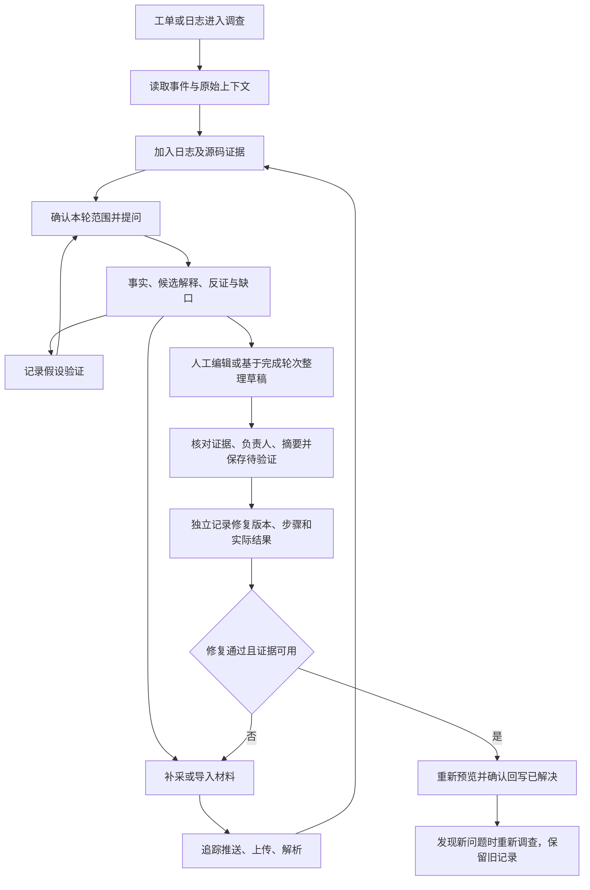

# Logan 工作台：产品交互定稿

> 当前回捞入口以 [阿里云回捞流程](aliyun-retrieval-flow.md) 为准：工单 / 手动参数 → 阿里云推送 → 客户端接收上传 → 平台接收后回捞成功。此前合成目录和命令字段仅保留作历史演练，不作为已确认协议。

更新：2026-10-21。本文将 [产品规格](specification.md) 落实为页面行为；配套 [可运行原型](../../../prototypes/logan-investigation/README.md) 和 [本轮验收记录](../../../prototypes/logan-investigation/evidence/product-alignment-2026-10-21/report.md)。真实接口约定仍以 [接口契约](api-contract.md) 为准。

> 采集交互已按 [流程更新](collection-flow-update.md) 修订并实现本地原型，补充独立采集、目标信息来源、三步发起及结果范围语义。之前的 [复审记录](collection-flow-review.md) 保留为问题发现依据。

## 1. 用户目标与页面结构

排查人员需要回答：现场发生了什么、哪些证据可以信任、还缺什么、如何验证、下一位处理人如何接着调查。日志阅读是主要工作区，工单负责保存问题范围和处理历史。

保留三个一级入口：日志阅读、采集任务、问题调查。进入调查后，左侧持续阅读日志，右侧使用源码、AI 排查、证据、补采、验证和回写六个工具。切换工具保留当前工单、日志批次、筛选和调查记录。筛选日志不会偷偷替换已发送的证据。

| 区域 | 显示与操作 | 用户得到的结果 |
| --- | --- | --- |
| 问题列表 | 现象、负责人、状态、下一步、证据数和更新数 | 接着历史调查继续工作，或新建问题 |
| 现场范围 | 设备、采集时构建、完整起止日期、工单 | 确认正在阅读的现场；跨日范围不省略结束日期 |
| 当前判断 | 回答轮次、依据任务、事实与候选解释、下一步 | 新证据尚未进入判断时明确提示；旧判断不随阅读切换改写 |
| 阅读区 | 文件、解析批次、时间分布、组合筛选、原始字段和关联请求 | 从事件进入源码、证据或提问；可返回原始上下文 |
| 调查工具 | 六个就地工具，共享当前调查 | 补采、验证、回写形成连续流程 |
| 结果提醒 | 全局未读数、所属工单、结果、查看和已读 | 回到对应采集结果，设备推送与站内提醒分别管理 |

## 2. 完整任务流程

人工调查可以直接整理草稿，无需先获得 AI 回答。AI 回答中的“支持假设”不等于修复通过。修复验证针对目标场景是否恢复，可独立记录；不要求将尚未确认的根因写成确定结论。

## 3. 采集与推送的交互规则

最新发起流程：确认目标 → 故障范围 → 核对发起。全局默认不关联工单；工单补采继承待核对线索。能力由目标目录提供，原能力演练下拉框退出业务表单。独立材料可以先阅读和重解析，再关联已有工单或建立问题。下表中的预计范围由目标能力决定，实际返回的文件与事件另行展示，不能凭请求计划或文件数量声称完整覆盖。详见采集流程更新。

| 状态或操作 | 页面反馈 | 后续操作与保留内容 |
| --- | --- | --- |
| 配置采集 | 展示设备能力、期望范围、预计范围、类型、预算、有效期 | 原型明确能力为合成配置；真实版从设备能力读取 |
| 仅支持按日混合采集 | 展示日边界范围；扩大范围须主动确认 | 保存两种范围及能力快照；混合文件解析后筛选，下载包含所有事件 |
| SDK 不支持 / Web 页面未运行 | 明确原因并阻止发送 | 可改用手动导入，不虚构设备响应 |
| 相同进行中请求 | 提供查看现有请求及明确新建独立请求 | 新建保留相似请求来源；不无提示重复创建 |
| 渠道接受 | 只更新渠道接受状态 | 设备送达、SDK 确认、上传、可查分别显示 |
| 渠道无送达回执 | 设备送达保持未知 | SDK 后续响应仍可使流程继续，不能倒推送达回执存在 |
| 部分成功 / 失败 | 文件逐项显示结果及已有重试入口 | 成功文件可阅读；失败种类另建关联重试，不覆盖原请求 |
| 取消 | 停止本地推进，提示已下发指令可能仍执行 | 保留文件与历史；迟到回执只追加事件，不重新激活请求 |
| 完成或失败提醒 | 可打开对应结果，标记已读 | 关闭后续提醒不删除历史提醒，不影响设备采集 |

迟到文件的人工关联属于真实联调待实现项；本轮仅演练迟到回执。采集样例使用固定演示时间，不会因选择任意日期生成真实现场日志。

## 4. 日志资产、解析与源码

原文件、解析批次和可读任务分别标识。上传导入、Web 样例、严格/宽松解析、失败行说明、重新解析、下载、筛选和历史批次继续保留。

| 情况 | 交互设计 |
| --- | --- |
| 解析进行中取消 | 当前批次标为已取消，保留原文件和批次；用户主动新建解析批次 |
| 重新解析成功或失败 | 新增批次；旧可读任务和历史证据引用不被覆盖 |
| 原文件过期 | 显示不可用原因；隐藏对应正文，阻止下载、重解析、加入证据和继续使用失效引用 |
| 源码版本匹配 | 显示采集时任务、文件位置和构建依据；才可作为对应现场的源码证据 |
| 关键词候选 / 映射缺失 | 明确置信边界；不能从工单当前版本借出“已匹配”身份 |
| 仓库不可访问 | 保留来源身份和缺口提示，隐藏内容；不以缓存片段继续生成判断 |

原型的过期和权限状态是可恢复演练，不执行实际内容删除或真实权限变更。恢复后保留同一条历史记录。真实服务需在读取、发送模型和导出时重新校验权限与保留策略。

## 5. AI 的证据与推理交互

1. 提问前查看本轮证据范围；可决定是否包含源码，输入框计数与实际发送范围一致。
2. 发送时固定证据快照。每轮显示包含和排除清单，保留任务、解析批次及版本身份；未核验的手动片段保持人工材料标识。
3. 结果区分日志事实、候选解释、反证、缺口及下一步。时间相邻不能自动证明因果；不同设备、构建、请求的事件不能拼为同一条因果链。
4. 补采后的文件先阅读、选择，再进入下一轮。下一轮展示新增或变化的证据，旧轮次保持不变。
5. 证据失效时阻止发送、原快照重试及回写；生成过程中失效则中断，避免发布不可追溯的新结论。历史身份保留，涉及失效内容的正文隐藏。
6. 可以停止、重试、追问或记录人工验证。未完成的轮次不能作为 AI 回写来源。

当前 AI 使用有限合成场景规则，不具备真实模型对任意日志的推理能力。真实模型的脱敏、授权、成本、质量评估仍需开发和联调。

## 6. 验证与工单回写

### 两类验证

- **假设验证**：支持、反驳、无法确定；记录方法、实际观察和证据，影响下一轮解释。
- **修复验证**：单独填写修复构建、场景、预期、实际结果、执行人、结果及至少一条证据，形成独立历史。

修复通过要求目标场景的实际观察。原型允许合成材料用于演练，但必须标注合成，不能声称设备已真实恢复。

### 回写面板

| 步骤 | 规则 |
| --- | --- |
| 选择来源 | 人工编辑，或选择一个已完成 AI 轮次；显示来源及证据范围 |
| 编辑 | 保存负责人、状态、摘要和引用；草稿支持刷新保留 |
| 核对 | 展示假设与修复验证数量，要求人工确认 |
| 版本变化 | 新增证据、验证或工单变化后提示草稿过期，禁止直接提交 |
| 重新预览 | 保留用户编辑文本，更新引用及版本，清除上次确认 |
| 保存 | 同一个草稿重复提交只形成一条更新；更新记录保存快照 |
| 标为已解决 | 工单须先处于待验证；最新修复验证通过且其证据可用，当前草稿也须有效 |
| 已解决后继续处理 | 通过重新调查进入下一轮，旧关闭记录及证据不覆盖 |

本地版本冲突演练用于表达交互；真实多人并发需由服务端版本号及幂等键保证。

## 7. 原有能力保留与开发对应

| 能力组 | 保留能力 | 本轮补齐 | 规格编号 |
| --- | --- | --- | --- |
| 日志 | 上传、Web 样例、解析失败及重解析、历史、筛选、上下文、下载 | 取消批次、资产过期演练、混合日志覆盖 | LOG-01～06 |
| 采集 | 工单发起、各阶段、失败/部分成功及重试、通知开关 | 能力范围、无回执、迟到事件、提醒入口 | COL-01～04 |
| 源码 | 精确身份、候选、缺失、变更与验证计划 | 不可访问及对应证据限制 | SRC-01～02 |
| 调查 | 多轮、补证、手动材料、假设验证、历史、导出 | 发送清单、人工回写、独立修复验证、草稿冲突和关闭条件 | INV-01～05 |
| 数据与控制 | 旧会话和业务记录、明确模拟范围 | 可选新增字段、刷新保留、自审与截图 | SYS-01～02 |

没有删除原有模块或重置浏览器数据。新增产品适配模块独立加载；沿用 localStorage v2。生产数据迁移、真实权限、内容清理、事务并发、外部工单和性能容量不由浏览器原型验收替代。

## 8. 页面实图与验收入口

[资产过期状态](../../../prototypes/logan-investigation/evidence/product-alignment-2026-10-21/expired-asset.jpg) · [源码不可访问状态](../../../prototypes/logan-investigation/evidence/product-alignment-2026-10-21/source-unavailable.jpg)。

验收按 [38 个场景](acceptance.md) 的 P（原型）、S（服务）、I（集成）、R（真实运行）层级分别执行。本轮只新增原型检查和规则测试，不把 90 项测试等同于 38 个场景全部完成。

## 回捞发起流程纠偏

以推送为入口：确认应用环境与推送绑定 → 配置日志回捞指令 → 确认并推送 → 等待通道 / 客户端回执 → 客户端上传 → 解析阅读。最终提交同时创建请求并模拟发送，不能只创建待发送任务却提示已发起。详细规则见 [采集流程更新](collection-flow-update.md#推送驱动的回捞流程纠偏)。
