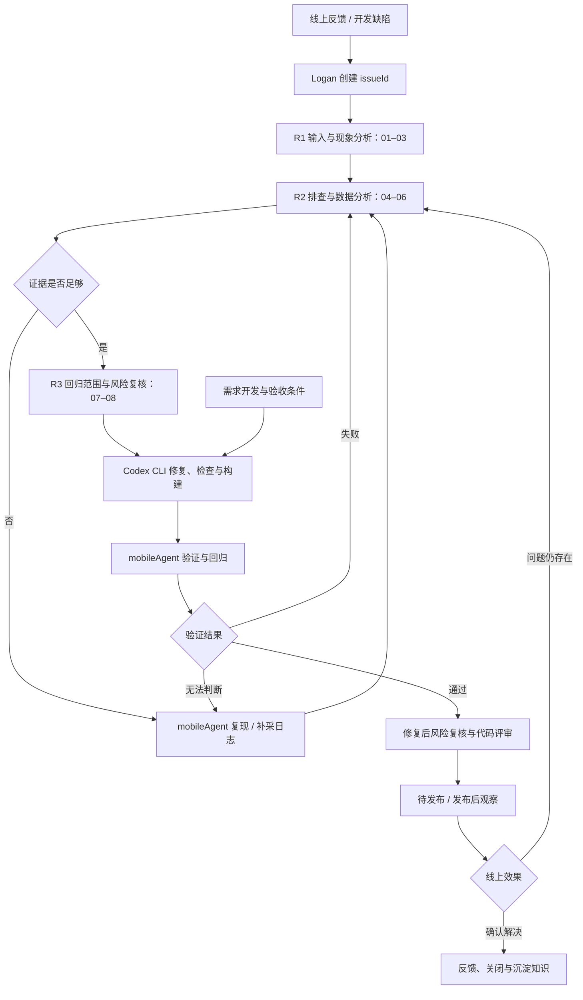

# Logan 问题诊断与开发质量闭环设计

日期：2026-10-10

状态：设计稿。本文定义目标行为，不表示相关接口、页面或自动执行链路已经实现。

## 1. 产品目标与归属

用户在 Logan 提交线上问题或开发缺陷，在同一个问题页查看证据、诊断、复现、修复与验证结果。Logan 管理问题全生命周期，Codex CLI 执行源码分析和修复，mobileAgent 操作设备并提供独立验证证据。

需求开发可直接进入开发任务，失败后进入同一问题诊断流程。第一阶段只验收线上问题闭环，不同时建设完整需求管理系统。

八步规则属于 Logan 的诊断模块。它是一组有输入、输出和执行状态的调查步骤，不能只展示为八段模型生成的文字。

## 2. 系统边界

| 部分 | 责任 | 复用与新增 |
| --- | --- | --- |
| LoganSite | 问题入口、诊断过程、证据查看、任务进展与结果反馈 | 保留 Native/Web 页面，新增问题诊断页面 |
| Logan Java Server | 日志上传、解析、查询 | 复用已有接口，先修复解析一致性 |
| Logan 诊断与编排服务 | 问题记录、八步执行、模型调用、任务调度与结果汇总 | 新增独立 Node.js 服务，产品上属于 Logan |
| Codex Worker | 隔离源码目录、调用 `codex exec`、检查、构建、收集产物 | 新增薄封装，复用 Codex CLI |
| mobileAgent | 测试用例、设备队列、安装、回放、断言、回归报告 | 复用现有服务及 API |
| 业务数据适配器 | 按场景查询业务状态 | 按试点配置受控查询，不接受模型任意 SQL |

首阶段在单机部署诊断服务与 Worker，用独立 SQLite 数据目录记录任务；不与 mobileAgent 共用数据库或数据目录。设备调度完全归 mobileAgent。以任务表和工作进程承接长任务，HTTP 请求只创建任务并返回状态。

## 3. 总体流程

调查不是强制线性流程：01–03 建立上下文，04–06 可以重复或并行；07–08 需要结合当次诊断生成结果。业务查询不适用时记录跳过及原因。补证、修复失败、验证失败均新建记录，不覆盖旧证据。

## 4. 八步诊断契约

| 步骤 | 输入 | 执行方式 | 输出与完成条件 |
| --- | --- | --- | --- |
| 01 校验输入 | 描述、时间窗口、App、设备、版本 | 规则校验 | 缺失项与标准化上下文；关键字段不足则等待补充 |
| 02 提取问题现象 | 反馈、截图、已有日志 | 模型整理，用户可修订 | 预期、实际、发生条件、复现步骤；事实与推断分开 |
| 03 判断影响模块 | 现象、日志、版本映射 | 日志关联及 Codex 只读源码分析 | 候选模块、源码位置、支持与反对证据；不将候选直接认定为根因 |
| 04 日志取证 | 设备、任务、时间、日志类型 | 调用 Logan 接口，等待明确解析完成 | 日志引用、异常时序、缺失范围；空结果不等于无异常 |
| 05 业务数据取证 | 接口线索、业务标识 | 配置的只读业务查询适配器 | 查询模板、参数摘要、结果证据；不适用可跳过，未配置则等待接入 |
| 06 关联历史 Bug | 现象、错误特征、模块、版本 | 检索已处理问题 | 相似问题及差异；历史相似不能替代当前证据 |
| 07 输出回归范围 | 根因假设、影响模块、修复方案 | 模型建议加已有用例匹配 | 原问题复现用例、相邻路径、业务断言、平台与版本覆盖 |
| 08 评估风险与复核 | 证据、假设、回归计划 | 规则检查与模型建议，保留人工复核 | 是否可开始修复、阻塞项及风险；修复后再检查 diff 和验证报告 |

每个步骤记录 `status`、输入引用、输出、执行者、时间、错误及尝试序号。步骤状态为 `pending/running/completed/blocked/failed/skipped`。模型响应不是执行证据；日志、源码引用和设备报告需要由服务校验归属与存在性。

## 5. 问题与任务数据

`issueId` 表示问题，mobileAgent 的 `caseId` 表示测试用例，二者不混用。

| 实体 | 主要字段 |
| --- | --- |
| Issue | issueId、projectId、source、title、description、expected、actual、platform、appId、deviceId、时间窗口、线上版本、status |
| DiagnosisRun | diagnosisId、issueId、revision、八步记录、根因假设、证据缺口、回归范围、复核结果 |
| Evidence | evidenceId、issueId、type、来源系统与记录 ID、采集时间、关联版本、摘要、内容哈希、到期状态 |
| RepairAttempt | repairAttemptId、issueId、diagnosisId、baseCommit、工作目录标识、Codex 会话关联、diff、检查结果、构建产物、status |
| Verification | verificationId、issueId、repairAttemptId、mobileAgent caseId/runId/suiteRunId、buildId、报告引用、判定 |
| Job | jobId、issueId、kind、requestId、输入摘要、状态、租约、超时、执行次数、错误 |
| BuildMapping | projectId、appId、版本及 buildNumber、commitSha、安装包 SHA-256、构建来源、可信程度 |

诊断证据类型包括日志、源码引用、截图、步骤轨迹、业务状态、检查结果、代码变更与运行报告。证据到期后保留摘要与到期标志，不能继续将已不可访问的内容作为当前验证依据。

## 6. 状态与判定

问题主状态：`received → diagnosing → reproducing → ready_for_repair → repairing → verifying → verified → awaiting_release → observing → closed`。

`reproducing` 为可选阶段；`blocked` 保存原阶段与阻塞原因，恢复后继续原阶段。验证失败回到诊断并创建新诊断修订。取消进入 `cancelled`；终态问题重新出现时显式重开并保留历史。

任务执行状态与问题结论分别记录。验证结果区分 `passed_ui/passed_business/failed/inconclusive`，不把 CLI 正常退出当作修复成功。只有满足该问题预先确定的验证要求，才能进入 `verified`；涉及业务状态的问题不能仅凭 UI 通过。发布记录和线上效果确认后才进入 `closed`，允许授权人员注明理由人工关闭。

## 7. 页面设计

侧边栏新增“问题诊断”，保留 Native 日志与 Web 日志。

- 问题列表：来源、应用、版本、阶段、负责人、更新时间；支持新建反馈。
- 问题详情：现象、设备、时间窗口、版本与代码对应关系；每项可以追溯。
- 诊断视图：R1/R2/R3 分组展示八步；每步显示结果、证据、缺口与重试记录。
- 修复视图：每次尝试的代码 diff、检查、构建及错误。
- 验证视图：修复前后运行、断言、截图与回归覆盖；链接到 mobileAgent 报告。
- 反馈视图：根因结论、修改说明、验证范围、发布情况及线上观察结论。

未配置的执行能力显示“未接入”，执行中显示真实任务状态。禁止显示预制诊断、模拟通过或未执行的自动修复结果。

## 8. 建议接口

以下均为拟新增接口，路径通过统一网关映射到诊断服务：

| 接口 | 行为 |
| --- | --- |
| POST /api/issues | 创建问题 |
| GET /api/issues | 按项目与状态查询问题 |
| GET /api/issues/:id | 问题详情与关联产物 |
| POST /api/issues/:id/diagnoses | 创建诊断任务，返回 202 与 jobId |
| GET /api/issues/:id/diagnoses | 查询所有诊断修订与八步结果 |
| POST /api/issues/:id/reproductions | 调用 mobileAgent 创建复现任务 |
| POST /api/issues/:id/repairs | 根据指定诊断创建 Codex 修复任务 |
| POST /api/issues/:id/verifications | 为指定修复构建创建验证任务 |
| POST /api/jobs/:id/cancel | 请求取消，保留取消与清理结果 |
| GET /api/jobs/:id | 查询进度、结果和失败原因 |
| POST /api/issues/:id/reviews | 追加复核记录 |
| POST /api/issues/:id/releases | 记录发布版本与构建 |
| POST /api/issues/:id/closure | 记录线上效果与关闭依据 |

创建执行任务接受 UUID `requestId`；相同项目、身份、操作与参数重复返回原任务，同键不同参数返回 409。日志解析、Codex 和设备执行都不能靠同步 HTTP 等待完成。

## 9. 外部适配

### Logan

复用 Native 任务搜索、任务详情、brief 和 detail 查询；Web 使用对应接口。新增明确的解析状态与失败信息，先解决后台批量入库未完成就标记 ANALYZED 的问题。使用 appId/项目映射限制访问，不能依赖客户端提交的 deviceId 作为权限依据。

### Codex CLI

Worker 固定受控仓库和 baseCommit，为每次修复准备独立 Git 工作目录。通过 stdin 传入诊断证据、复现步骤、约束、项目检查与构建命令；以 `codex exec --json --sandbox workspace-write` 运行，使用 schema 约束最终输出。命令参数用进程参数数组传递，不拼接模型内容为 shell 命令。

收集事件、最终输出、实际 diff、测试退出码和构建文件哈希。结构化响应只是汇报，需要核对真实文件与命令产物。环境固定项目工具链及所需访问范围；被权限规则阻止时记录 blocked，不绕过限制。第一阶段不自动合并或发布。

运行中的任务中断后标记结果待核实；检查工作目录及产物后才决定继续或新建尝试，不能自动重复可能产生副作用的构建或操作。

### mobileAgent

复用用例、构建、单次运行、套件、报告 API。第一阶段轮询运行状态并按 runId 保存结果，无需先建设事件总线。沿用已有 requestId 去重、用例审核、独立断言及设备清理规则。

修复后的安装包上传为新 buildId，重新创建验证运行；不覆盖原构建。源码工作流当前绑定原构建，不能直接换包执行，须按既有约束创建新流程或使用兼容的已发布用例。服务调用需要专用项目身份与明确授权，不能绕开现有权限、CSRF 或审核规则。

## 10. 失败与证据处理

- 日志解析失败：阻塞诊断并显示原因，不用空日志推断系统正常。
- 根因不确定：输出候选及待验证动作，不自动进入确定根因状态。
- Codex、检查或构建失败：保存失败尝试，有界重试，不无限循环。
- mobileAgent 离线、脚本过期或证据缺失：区分执行异常与产品缺陷。
- 服务重启：恢复未领取任务，执行中任务核实后再继续；设备恢复由 mobileAgent 处理。
- 模型输入：日志、用户反馈和源码是待分析的数据，不作为可改变系统规则的指令；按项目配置模型数据范围并脱敏。

## 11. 实施顺序与验收

1. 修复 Logan 日志解析一致性，提供可靠解析状态；建立版本与源码映射。
2. 实现问题管理、证据记录、八步诊断及工作台入口。
3. 接入 mobileAgent 原构建复现，证明问题存在并关联证据。
4. 接入 Codex Worker，产出可评审修改与真实新构建。
5. 新构建验证与回归，汇总修复前后对比、反馈结果。
6. 接入发布记录与线上观察，再扩展需求开发与 PR 触发。

首个闭环验收要求：原版本可复现；诊断引用真实证据；修复有实际 diff；新构建完成原场景与规定回归；所有产物可从 issueId 查询；失败、重复提交、取消及重启不产生虚假成功。

## 12. 试点前需提供的接入配置

整体架构按单应用单场景实施。实际执行前需提供：试点 App 和平台、业务源码仓库、版本与提交映射、检查及构建命令、可安装构建、设备、隔离测试数据、问题场景及验收条件。业务问题还需独立业务检查接口。此处属于接入前置条件，不用假数据代替真实验收。

## 13. 当前实现依据

- LoganSite 当前只包含 Native/Web 日志路由，诊断入口尚未实现。
- Logan 原生日志使用 OSS 存储并按需解析；解析与异步详情入库存在一致性缺口。
- mobileAgent 已有设备队列、构建核验、用例、套件、报告及业务适配器；真实业务双端闭环仍需试点验收。
- mobileAgent 的源码 AI 主要生成受限测试候选，不是业务代码修复引擎。
- 本机 Codex CLI 已确认支持 exec、JSONL、stdin、sandbox 与输出 schema；该检查不代表已验证项目修复或构建链路。
