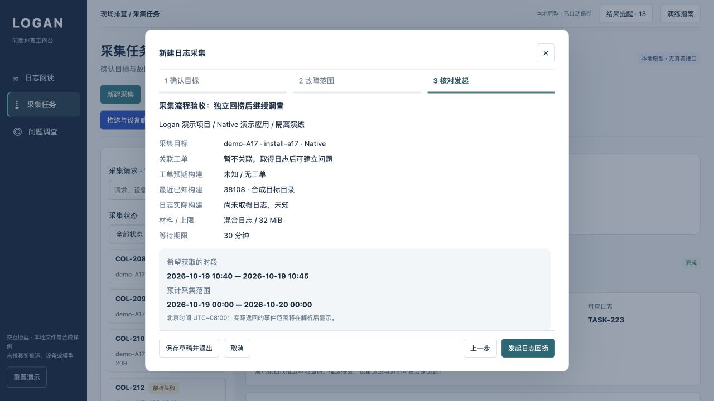

# 采集流程更新验收

日期：2026-10-21。范围：本地交互原型；目标与日志均为合成样例，无真实接口。设计说明见 [采集流程更新](../../../../docs/product/2026-10-21-logan-workbench/collection-flow-update.md)。

## 浏览器实际走查

| 路径 | 实际结果 |
| --- | --- |
| 全局新建 | 不再默认关联上一次工单；三步表单底部操作固定可见 |
| Native 目标 | 目录展示 install-a17、最近已知构建 38108、按日能力及来源；预计范围扩大需确认 |
| 独立采集 COL-225 | 不创建占位工单；无送达回执场景仍能收到 SDK 响应并得到 TASK-225 |
| 返回材料 | 5 条事件可筛选；日志声明构建 38107，不被设备最近构建 38108 替代；观察时间与预计整日范围分开 |
| 独立重解析 | 新建 LOG-009/P1 并完成，保留原请求；没有再次发送设备请求 |
| 建立问题 | 明确确认后新建 ISS-1049，COL-225 原 ID 与来源键保留，解析资产带入资料库 |
| 源码与 AI | L5 与 S5 两项证据进入 R1，源码显示 build 38107；回答区分事实、候选与缺口 |
| 回写 | 保存一条调查中更新，负责人“采集流程验收”；刷新后更新和证据保留 |
| Web 草稿 | 填写现象及样例时间，保存退出、刷新、重新打开后保留；平台和能力仍为 Web |
| 离线目标 | 选择 Web 离线样例后下一步被阻止，说明原因并提供保存草稿、导入路径 |
| Web 部分成功 COL-226 | 返回应用文件，4 条 Web 事件可读，失败的网络类型不出现；实际构建 web-38107 |
| 重试 COL-227 | 只重试网络日志，原 COL-226 保持部分成功；成功后读取 1 条 BrowserNetwork 事件 |
| 工单补采 COL-228 | 从 ISS-1049 自动带入线索和时间，提交后停留在当前调查，原阅读日志仍在；取消后记录保留 |
| 刷新定位 | 新请求稳定键在全部适配加载后恢复，刷新仍定位 COL-226/COL-227，没有回退至首个旧请求 |

旧数据没有重置或清理。本轮新增 COL-225～228、ISS-1049、LOG-009 及对应合成调查记录。未逐项重新执行历次所有 UI 验收；原有 90 项自动测试保留并纳入回归。

## 自审修正

- 独立请求的元数据从目标记录取得；实际构建在文件返回前保持未知。
- 新旧来源键不同导致刷新回退：保留启动时选中项，在源适配加载完成后恢复，并增加回归测试。
- 新来源键的导出与解析入口：导出包含目标、预期、计划、观察和事件；解析显示日志声明构建。
- 部分上传失败：阅读、下载、观察范围及后续任务只包含已返回且可读的类型；失败文件不计为已收到。
- 原事件文案自动声称关联工单：新独立请求使用“尚未关联工单”的记录。
- 列表按创建时间优先显示新请求；详细时间线折叠，下一步和处理操作提前。

## 自动验证

共 **106 项测试通过**：原有 90 项，加本轮 8 项纯规则与 8 项适配集成测试。覆盖独立关联、未知身份、Web 切换、日粒度确认、实际构建、部分成功、重试、解析、稳定键、导出以及不污染上一工单上下文。

语法、文档链接、预览副本一致性及仓库检查见 [checks.json](checks.json)。浏览器本轮未捕获 warning/error。

## 截图

[目标来源](target.jpg) · [Web 核对页](web-confirm.jpg) · [Web 部分成功材料](web-partial.jpg) · [采集结果](collection-result.jpg)。

## 边界

没有接真实设备发现、在线查询、SDK、推送、仓库、模型或外部工单。目标目录仅三个合成记录。独立重解析直接执行本地自动严格解析；关联后使用现有完整解析配置与历史。真实覆盖证明、真实多人权限/事务、设备能力新鲜度和容量尚未验收。未知目标有保存草稿及现有导入入口，导入仍需选择已有工单。
