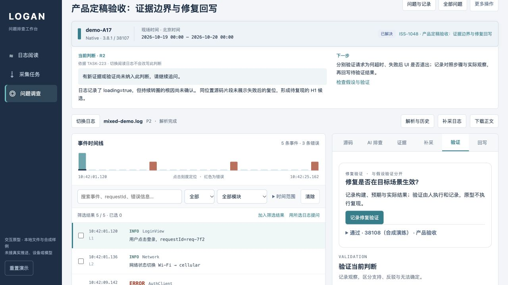
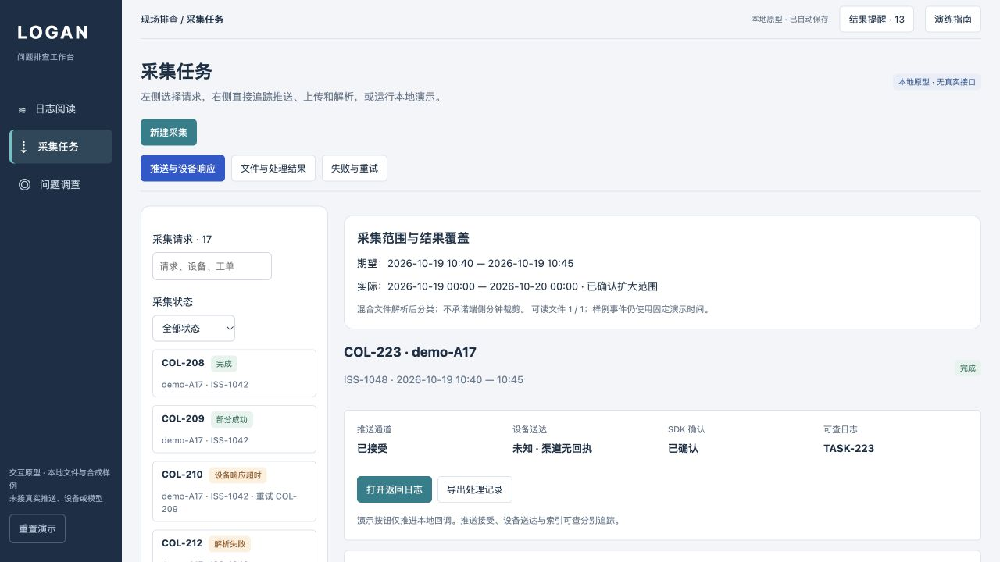

# 产品交互对齐验收

日期：2026-10-21。范围：本地交互原型和新增产品规则；未接真实接口。配套 [产品交互定稿](../../../../docs/product/2026-10-21-logan-workbench/product-design.md)。

## 结果

原有 72 项测试与新增 18 项共 **90 项通过，0 失败、0 跳过**。新增测试覆盖采集能力范围、未知回执、混合文件、证据失效、AI 发送清单、独立修复验证、草稿变化、重复提交及重新调查。浏览器按下面记录进行了实际交互；未把测试数量等同于开发规格中 38 个场景全部通过。

## 本轮浏览器记录

预览：http://127.0.0.1:3011/ 。新建独立工单 **ISS-1048 · 产品定稿验收：证据边界与修复回写**，全部使用本地合成材料。

| 操作 | 观察到的结果 |
| --- | --- |
| 尚无 AI 轮次时进入回写 | 人工草稿可编辑；填写负责人和摘要后可保存为调查中 |
| 模拟工单版本变化 | 旧草稿提交受阻；重新预览保留编辑文字，并要求重新确认 |
| 按日混合采集 | 未确认扩大范围时受阻；确认后创建 COL-223，期望 10:40–10:45、实际 10 月 19 日 00:00 至 20 日 00:00 分开显示 |
| 渠道无送达回执 | 送达保持未知；SDK 确认、文件上传和解析后发布 TASK-223；没有补造送达回执 |
| 读取混合文件 | 显示 5 条事件，应用与网络事件均存在 |
| 日志 L5 加入调查并关联源码 | 保存日志及对应样例源码证据；版本身份来自采集任务 |
| 演练 L5 证据过期后提问 | 阻止发送；恢复后同一证据继续可用，未删除原内容 |
| R1 排除源码 | 实际快照包含 1 条日志、排除 1 条源码；调查范围内的源码未被删除 |
| 补入 L3 并发送 R2 | 2 条日志与 1 条源码进入新轮次，显示增量；R1 保留原范围 |
| 直接尝试已解决 | 被关闭条件阻止；先回写待验证成功 |
| 补入 M1 合成修复记录 | 新建独立修复验证：38108（合成演练）、场景、预期、实际观察、执行人和证据齐全 |
| 修复验证后回写 | 保存已解决；摘要明确为合成演练；刷新后 4 项证据、3 次更新及独立验证仍存在 |
| 混合日志重新解析 | 创建 LOG-008/P1，取消后保留历史，再建 P2；P2 完成并读取 5 条记录，不覆盖原 COL-223 |
| 原文件过期演练 | 正文及相关操作受限；恢复后原资产、取消批次和成功批次均保留 |
| 源码不可访问演练 | 隐藏源码和受影响的判断，展示缺口；恢复后继续调查 |
| 不支持远程采集 | 阻止创建并提供手动导入替代路径 |
| 取消并收到迟到回执 | COL-224 保持已取消，追加迟到事件，不自动关联文件或重启请求；刷新保留 |
| 结果提醒 | 14 条历史提醒可见；打开 ISS-1048 提醒直达 COL-223，未读降至 13 |
| 数据回归 | 旧 ISS-1042～1047 的证据及更新计数与操作前一致；没有重置演示数据 |

## 自审发现及修正

- 按日混合文件最初未被旧下载分支识别：补齐阅读与下载覆盖，并用集成测试检查应用和网络内容同时存在。
- 跨日范围只显示结束时间容易误读：跨日时显示完整结束日期。
- AI 排除源码后输入框计数容易与实际快照不一致：改为显示实际包含的数量，并保存包含/排除清单。
- 结果摘要原来只计算假设验证：分别显示假设验证和修复验证数量。
- 证据可用性不能只在添加时判断：补齐生成前、生成结束、原快照重试、回写和导出的限制。
- 重新预览不能覆盖用户编辑：保留摘要、负责人和状态，重新确认引用及版本。

## 检查方式与截图

自动测试使用 `node --test prototypes/logan-investigation/*.test.js`。本轮新增文件进行了语法检查；文档链接和仓库检查结果见 [检查记录](checks.json)。浏览器完成操作后未捕获 warning/error。桌面界面已查看；本轮未重新执行所有历史页面的视觉验收或移动端专项验收。

[原资产过期](expired-asset.jpg) · [源码不可访问](source-unavailable.jpg)。截图是当时 UI 状态；刷新验证和规则测试补充验证保存行为。

## 保留范围与未执行项

旧日志上传、Web 样例、失败重解析、筛选、源码候选、多轮追问、部分成功重试及导出模块保留，原有测试全部通过。采用可选新增字段沿用 v2 存储；本轮未删除已有数据。没有逐一重跑历次所有上传样本，历史证据见原型 README 中对应验收报告。

原文件过期、仓库撤权和版本冲突均为可恢复本地演练，不是实际数据清理、真实权限系统或跨用户并发控制。迟到文件人工关联、真实 SDK 能力、设备推送、构建映射、模型质量、数据库事务、容量及生产发布验收未执行。新建独立相似请求和重新调查的规则具备实现，其中重新调查有规则测试，本轮未另跑这两个浏览器分支。
