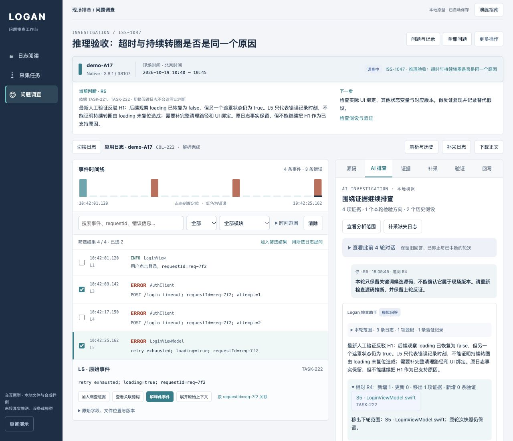
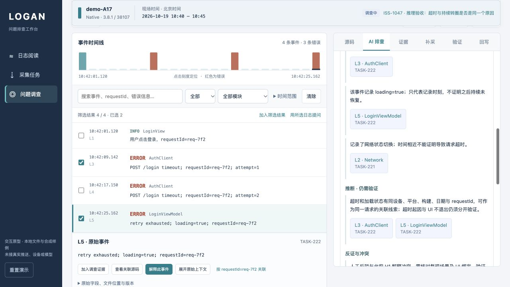

# 按排查逻辑验收：证据、关联、补采与反证

日期：2026-10-20。预览：http://127.0.0.1:3011/#workbench 。本轮使用新增 ISS-1047，未重置浏览器数据。

## 结论

原型此前“可以走通操作”，但证据与判断之间存在实质缺陷。本轮复现并修复了这些缺陷，完成“网络侧证据不足 → 补应用日志与源码 → 候选解释 → 人工反证 → 源码降级为候选 → 保留未知项回写”的过程。最终工单保持调查中，未把演练当作根因确认或修复完成。

## 发现与修复

| 问题 | 复现或检查依据 | 修复后的行为 |
| --- | --- | --- |
| 日志下标替代日志事实 | 自动测试：普通第五条日志被解释为 loading=true | 从配置场景的日志正文识别显式事实；日志重排不改变判断；普通导入和手动材料不套固定诊断 |
| 证据不足仍生成两个默认假设 | 浏览器 R1：只有网络切换，仍生成 H1 加载未恢复与 H2 网络导致超时 | 按当前证据提出检验方向；旧假设保留，但标明当前轮不足以支持，不再计作本轮方向 |
| “源码匹配”标签被当作缺陷依据 | 原规则只看索引、模式及部分身份 | 检查任务、设备、平台、版本、构建、文件和行号；检查片段是否实际展示失败分支/复位，缺失映射不作代码依据 |
| 超时、状态与网络事件容易拼成因果链 | 原回答缺少逐项关联校验与引用 | 同请求关联要求设备、平台、版本、构建、日期和 requestId；关联仍只表述为线索，超时起因与 UI 不退出分开验证 |
| 补采后难以看出判断依据的变化 | 原回答只显示总证据与一段回答 | 展示相对上一轮新增、更新、移出证据及新增验证；事实、推断、冲突分别引用相关证据 |
| 人工反证未充分反映在推断列表 | 新增 H2 反驳用例先失败 | 反驳 H1/H2 后撤下对应支持性推断，保留事实，显示冲突并改变下一步 |
| 任务版本可能随工单编辑漂移 | 自动测试：创建采集后修改工单版本，旧任务没有版本快照 | 新请求/任务固定保存当时版本、构建、平台和时间；旧任务缺失版本快照时仅作工单线索，不假装已匹配 |
| 回写只保留一段结论难以复核 | 检查原回写数据与展示 | 保存逐项事实、推断、冲突、变化说明及引用；展示用日志标签和任务号，不混淆内部零基索引 |

## 浏览器实际演练

### R1：修复前复现

新建 ISS-1047，设备 demo-A17、3.8.1/build 38107、现场时间 2026-10-19 10:40–10:45。仅采集网络日志，COL-221 经推送接受、设备送达、SDK 确认、上传、解析发布 TASK-221。只有 L2“网络状态切换 Wi-Fi → cellular”。

R1 虽然回答证据不足，却生成 H1、H2 两个默认假设。保留 R1 作为问题复现记录，未改写旧答案。

### R2：证据不足时停在事实

修复后追问，系统仅列网络切换事实，明确缺少请求超时、应用状态及完整请求身份。没有把网络变化当作超时原因。原 H1/H2 作为历史假设保留。

### R3：补采后推进调查

在同一工单补采应用日志，COL-222 发布 TASK-222。运行及完成期间仍停留 TASK-221；显式打开补采日志才切换。

选择 L3 请求超时、L5 重试耗尽时 loading=true，并加入 LoginViewModel.swift:124 的同构建源码。R3 明确新增三项证据，并逐项说明：

- 超时只说明请求失败，不能直接归因服务端。
- loading=true 只代表记录时刻，不能直接证明持续未恢复。
- 同位置源码片段未展示失败后的复位；片段之外的清理未知。
- 应用超时和状态可按同设备、构建、日期、requestId 关联。
- 网络切换仍缺少请求身份，不足以确认其导致超时。

### R4：加入反证后改变判断

人工输入合成验证：假设后续 loading 已恢复，但另一遮罩状态仍为 true。验证标为反驳 H1，引用 L5。R4 展示新增一条验证，保留原日志事实，撤下 H1 的支持性推断，增加冲突说明，下一步转向完整清理路径、UI 绑定和替代假设。

此观察仅为人工填写的本地反证演练，没有运行设备或源码。

### R5：源码降级与历史快照隔离

把已匹配源码移出下轮范围，加入关键词候选源码。R5 显示新增一项、移出一项，不再使用候选源码支撑失败分支缺陷，明确缺少已匹配源码。R4 的反证继续有效。

重新打开 R3 的源码引用，仍显示当时已匹配的完整片段、日期、requestId、build 38107、LoginViewModel.swift:124，未被 R5 的候选状态覆盖。原网络引用也正确返回 TASK-221，而不是当前 TASK-222。

### 回写与刷新

将 R5、四项证据、一条反证记录及未知项写入工单，负责人“证据与推理验收”，状态“调查中”。保存后刷新仍保留一次更新。草稿区分本轮检验方向和含历史的人工假设记录，没有将旧 H2 自动恢复为已支持原因。

## 旧数据与能力

本轮操作前后核对原工单的证据/更新数量：

| 工单 | 证据 | 更新 |
| --- | ---: | ---: |
| ISS-1042 | 9 | 5 |
| ISS-1043 | 1 | 0 |
| ISS-1044 | 5 | 3 |
| ISS-1045 | 3 | 1 |
| ISS-1046 | 4 | 1 |

这些数量保持一致。未执行重置、旧记录删除或存储迁移。未重新生成旧轮次答案。新记录集中在 ISS-1047、COL-221/222 及五轮对话。日志导入、解析失败重试、Web 样例、下载、证据补充、验证、旧历史和原导航实现保留。

## 验证范围

- 全部 72 项自动测试通过，0 失败、0 跳过，其中新增 17 项证据推理回归。测试先复现了错误，再修复通过。
- 原有日志导入、Web 解析、失败重解析、历史隔离、采集状态、AI 轮次和导航测试全部通过。
- 全部原型 JavaScript 语法检查通过；本轮浏览器检查未捕获 JavaScript 错误。
- 本轮没有再次穷举所有旧按钮组合，也没有清空旧数据测试重置。

## 截图

## 实际能力边界

仍未接真实接口、推送、仓库或模型。这里是有限登录场景的可复核规则模拟，不是任意日志推理或完整程序控制流分析。源码片段中未出现复位，不代表整个程序没有复位；单条状态日志不代表持久状态；人工验证记录不等于系统执行或确认。任意导入与手动材料可解析、阅读、保留和引用，但不会被本地规则当作真实根因证明。
