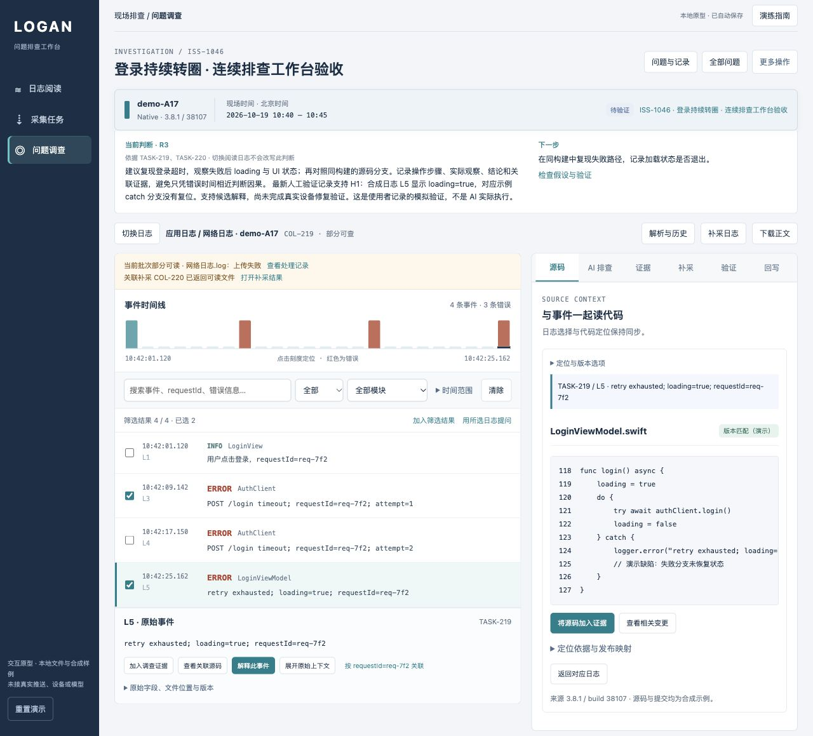
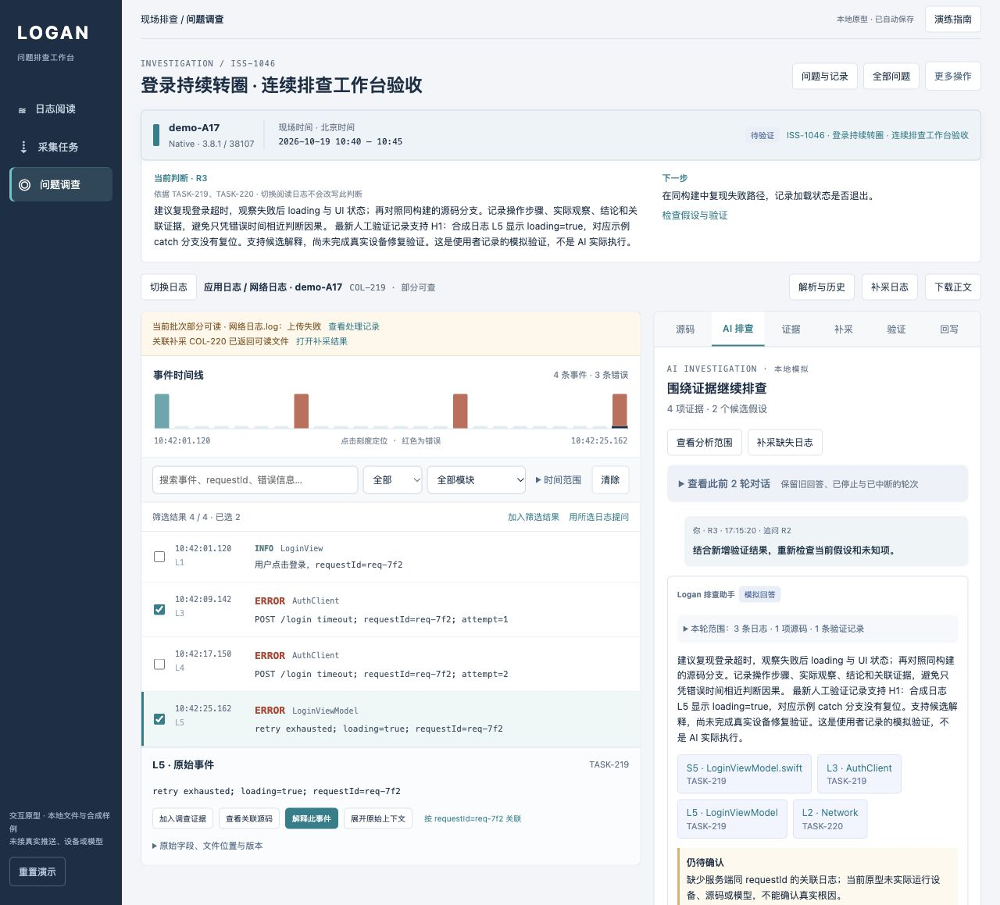

# 连续排查工作台验收

日期：2026-10-20。预览：http://127.0.0.1:3011/#workbench 。本报告只描述浏览器本地原型。

## 本轮设计

导航收敛为日志阅读、采集任务、问题调查。固定设备、平台、构建、现场时间和工单信息；中央阅读事件时间线及原始日志，右侧切换源码、AI、证据、补采、验证和回写。切换工具时保留日志上下文。

同一文件的解析批次归在一个资料条目下，失败批次仍可打开。补采到达不自动替换当前日志，原批次的缺失状态与关联补采结果同时展示。当前判断标明来源任务，切换阅读日志不会改写已有结论。历史引用定位原任务、原事件及原版本。

## 实际跑通的完整流程

新建独立演练工单 ISS-1046，设备 demo-A17、版本 3.8.1、构建 38107，现象为登录持续转圈。

1. 在工单工作台发起 COL-219，本地推进推送与设备响应、上传及解析。应用日志成功、网络日志上传失败；TASK-219 仅出现 L1/L3/L4/L5 四条可读事件。
2. 选择 L5 查看对应 LoginViewModel.swift，加入源码证据；选择 L3/L5 提问。R1 使用三项证据。
3. 仅重试失败网络文件，生成关联 COL-220。执行和完成期间仍停留 TASK-219/L5；明确打开补采结果后切换到 TASK-220，仅含网络事件 L2。
4. 将 L2 加入证据并继续 R2。记录 H1 验证步骤、合成日志观察、支持结论及 L5 引用，再发起 R3。R3 使用四项证据和一条验证记录。
5. 回写草稿设为待验证并填写负责人，切换到源码后返回草稿，内容保留。人工核对后保存，仍在原工作台，显示 R3、四项证据、一条验证及一次工单更新；刷新后保留。
6. 在 TASK-220 阅读范围点击历史源码引用 S5，正确返回 TASK-219/L5。源码变更可加入待验证检查项，验证页显示该项。

人工观察明确标注为合成演练，未把“支持候选解释”当作真实修复验证，也未自动将工单关闭。

## 日志能力回归

- 实际通过文件选择器导入 `fixtures/web-partial.jsonl`，产生 LOG-007/P1。严格策略因第二行无效而失败，无可读任务。
- 在同一工作台调整为跳过错误行并重新解析，LOG-007/P2 变为部分可读，发布两条事件；原 P1 失败批次保留。工作台内能显示解析进度更新。
- 导入样例事件日期与声明现场日期不同，界面显示范围不匹配提示，未静默改写现场。
- 既有 LOG-002 的 P1/P2 归组显示；选择失败 P1 不会误读 P2 或其他任务。
- 既有 Web 工单 ISS-1045 的 LOG-005/P2 保留五条浏览器事件；L5 对应 LoginPanel 的 TSX 示例，不使用 Native 的 Swift 示例。
- 搜索 timeout、展开原始上下文、返回筛选及刷新保留通过。零命中时日志详情与源码不显示无关事件。
- 源码匹配/缺失状态可切换；缺失时不显示虚假的匹配代码。重复加入已有证据保持去重。

## 数据与旧能力保留

沿用 `logan-investigation-prototype-v2`，新增界面偏好独立保存；未清空或迁移旧业务对象。原工单检查前后的证据/更新数量一致：

| 工单 | 证据 | 更新 |
| --- | ---: | ---: |
| ISS-1042 | 9 | 5 |
| ISS-1043 | 1 | 0 |
| ISS-1044 | 5 | 3 |
| ISS-1045 | 3 | 1 |

原 LOG-001 至 LOG-006、历史解析批次、旧轮次与引用继续可访问。新增验收数据集中于 ISS-1046、COL-219/220 和 LOG-007。未执行重置演示。上传导入、Web 样例、手动补证、通知、下载导出、旧采集状态和失败重试实现均保留；本轮没有重新穷举所有历史功能的按钮组合。

## 自动与视觉检查

- `node --test prototypes/logan-investigation/*.test.js`：55 项通过，0 失败，0 跳过；原 45 项及新增 10 项。
- 所有原型 JavaScript 语法检查通过。
- 新增测试覆盖资产批次归组、精确历史选择、失败后保留旧可读批次、工单隔离、日志筛选、时间分布、历史引用返回、补采上下文以及回写后的草稿状态。
- 浏览器最后一次检查未捕获 JavaScript 错误。
- 390px 窄屏文档宽度为 390px，无页面横向溢出；阅读与源码上下排列。已恢复默认窗口尺寸。
- `Logan` 业务仓库工作区保持干净；本轮只改本地原型及文档。

## 截图

[窄屏阅读检查](mobile-reader.png)

## 仍然保留的边界

本地导入在浏览器解析；推送、设备、源码映射、变更及 AI 回答仍为模拟，未连接真实接口。AI 仅按有限主题和附加证据生成示例回答，不代表具备任意问题的推理能力。未验证生产级大日志容量、真实 SDK/推送链路、加密解码或实际修复效果。导入和采集仍关联已有工单，未改变业务对象结构。
